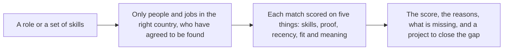

# NEXTSTEP

NextStep helps young people in **Nigeria, South Africa, Kenya and Ghana** find work and opportunities that match what they can actually do. It helps employers and small businesses find people they can trust, and it shows the reasons behind every match.

## The problem

**Young people** have skills, but a CV is only a list of claims. Good candidates get filtered out for their name or their school. Opportunities are spread across many sites, and most of them are out of date.

**Employers and small businesses** struggle to tell who really has the skills they need. They lose time to fake listings and to candidates who are not a fit.

**Everyone** gets the same thing from most job sites: more listings and more sign-ups. NextStep measures the thing that matters: people placed in work, and still in it six months later.

## What NextStep does

| Who | What they get |
|---|---|
| **Young people** | Opportunities open in their own country, with a clear reason for each one: which skills they have, which are missing, and a small project to build the missing ones. |
| **Employers** | Candidates ranked for a role, with the score broken down so they can see why. Contact details will be shared only after the candidate accepts. |
| **Small businesses** | The same search as employers. |
| **Schools and placement offices** | A way to share their current vacancies with their students. This will run under a written agreement. |
| **AI assistants** | Typed tools that let an assistant search and explain matches, with access limited to what the user has agreed to share. |

## How matching works



Every score is between 0 and 100 and falls into a band: **strong** (80 and above), **good** (60 to 79), **partial** (40 to 59), or **weak** (below 40).

Proof counts for more than a claim. A skill backed by a verified project or an assessment is worth more than one the person only declares. A skill nobody has used for years counts for less, but never zero, so career breaks are not punished. Explanations only mention skills that are in the person's own record.

## Status

### Working now

These work with demo data. The job postings in the demo are real and come from public job boards.

| Feature | What it does |
|---|---|
| Skills list | 303 skills in 20 areas, with the other names people use for them |
| Scoring with reasons | Every match shows its score, its parts, and what is missing |
| Profiles and CV matching | Upload a CV (PDF, Word or text, up to 5 MB). The skills in it are recognised, and each listing in your country is scored against them on your dashboard. Delete your profile at any time |
| Opportunities in your country | Listings open to you by default. A global view is available and clearly labelled |
| Job data from employers | Public postings from six employer job boards, each linked to the employer's own page |
| Web app | Landing page, opportunity directory with filters, opportunity pages, and the standards and legal pages |
| AI tools | Six read-only tools for assistants. They need a valid access token |
| Paging | Long lists load a page at a time, which keeps them light on slow connections |

### Not ready yet

| Feature | Status |
|---|---|
| Sign-in and accounts | Not built. A development stand-in lets a profile be opened without an account |
| Permanent storage | Not built. Profiles and the development data reset on restart. The CV file is read and then discarded, not kept |
| Certificates and other attachments | Not built. They will be scanned before use |
| Database | Not built |
| Employers posting jobs | Not built |
| Skill extraction from CVs and listings by AI | Off. It waits for an AI provider to be chosen and reviewed |
| Contact requests | Not built. Contact details will be shared only after the candidate accepts |
| School and placement-office vacancies | Not built. Waiting for an agreement with a partner institution |
| Live job refresh | Not built. The demo data is a snapshot |

## Problems we ran into, and what we did

| Problem | What we did |
|---|---|
| **Unfair screening.** Names, gender, age, photos and school prestige could sway a score. | These are never used in scoring. Equal-opportunity text in job ads is ignored when matching skills. A check on real postings fails the build if this rule breaks. |
| **Diversity statements created false matches.** A job ad listing "caregiving status" as a protected category was matching the skill "caregiving". | Found while testing on real postings. Those statements are now skipped. |
| **Company boilerplate created false matches.** One employer's "about us" listed customer brands, so a skill was matched for a brand name. | Company descriptions are skipped when matching skills. Postings written in other scripts are not matched against the English skills list. |
| **Fake or unsafe listings.** | Partner listings will be reviewed by a person before they go live, and nothing is published automatically. Employers will verify their business registration. Every listing and profile will have a report button. |
| **AI inventing facts.** | Explanations can only mention skills in the person's record. Anything else is dropped. Results are checked against a fixed structure before they are shown. |
| **Hostile text in CVs and profiles.** Someone could write instructions to the AI inside their CV. | Profile text is treated as data and never as instructions. It never reaches the AI's system prompt, and tools cannot be triggered from it. |
| **Scraping LinkedIn.** Its terms forbid it. | We do not scrape LinkedIn. A candidate can upload their own LinkedIn profile export as a CV. Official LinkedIn integration may come later, once its terms are checked. |
| **Scraping other sites.** It can break terms and privacy law. | We use official job-board data, with links to the original posting. A generic scraper exists only in design, behind a permission check per site. |
| **Job ads from outside Africa.** A global employer's role may or may not be open to people in our countries. | Each listing records where it is open. Youth see local listings first. Global listings show a clear label. |
| **Personal data.** | Members choose whether employers can find them. Field-by-field choices are being built. We collect the minimum, and national ID numbers are not collected. |
| **Slow connections.** | Lists are paged. Responses are compact. A text-only mode and an SMS or WhatsApp channel are planned. |
| **Cost and data location.** An outside AI provider could send personal text abroad. | Embeddings are designed to run on our own server, using an open model. No AI provider is used until one is chosen and checked against the data-protection law of all four countries. |
| **Demo data that looks real but is not.** | The demo uses real public postings, each linked to its source. Placeholder text is never shown as if it came from an employer. |

## Try it

The web app shows the demo data. The postings are public job ads from the employers' own job boards. NextStep does not endorse these employers and has no partnership with them.

Prerequisites: Node.js 20.19 or newer (22 recommended) and pnpm.

```bash
pnpm install          # uses the committed pnpm-lock.yaml
pnpm dev              # open http://localhost:5173
```

Other commands:

```bash
pnpm test             # filter and sort logic
pnpm typecheck
pnpm build            # outputs dist/
pnpm preview          # serves dist/ at http://localhost:4173
```

To see your own matches, run the development API alongside the web app. It keeps everything in memory, so it resets on restart:

```bash
cd backend && uvicorn api.asgi:app --reload
```

Then open `/profile` in the web app, upload a CV, and open `/dashboard` to see your matches.

The app reads `public/data/opportunities.json`, a copy of the demo postings. Once the REST API has a database behind it, the app will switch to the live endpoint. See [docs/FRONTEND.md](docs/FRONTEND.md) for the routes and design rules.

Deployment: `infra/render.yaml` defines a Render static site that runs `pnpm build` and publishes `dist/`, with security headers set. The API is not deployed yet, because it needs the database first. See [docs/DEPLOYMENT.md](docs/DEPLOYMENT.md).

## For developers

Backend setup, configuration, the embedding model, and the test suite are in [backend/README.md](backend/README.md). The short version: 275 tests run with no database, no model download, and no network access.

## Documents

| Document | What it covers |
|---|---|
| [docs/ARCHITECTURE.md](docs/ARCHITECTURE.md) | How the system is built: parts, deployment, main flows, and the reasons behind key decisions |
| [docs/TECHNICAL.md](docs/TECHNICAL.md) | Detailed rules: matching, scoring, ingestion, sources, attachments, and models |
| [docs/DATABASE.md](docs/DATABASE.md) | What is stored, how it is protected, and how long it is kept |
| [TROUBLESHOOTING.md](TROUBLESHOOTING.md) | Problems and fixes, by symptom |
| [DESIGN.md](DESIGN.md) | Page designs: look and feel, sitemap, and what each page does |
| [docs/FRONTEND.md](docs/FRONTEND.md) | The web app: structure, data, filters, testing, and deployment |
| [docs/PROFILES.md](docs/PROFILES.md) | CV upload, skill extraction, scores on the dashboard, sessions, privacy and limits |
| [docs/DEPLOYMENT.md](docs/DEPLOYMENT.md) | The Render runbook: what is ready, what blocks the API, and the steps to switch it on |

The source specification is `Youth_Yellow_Pages_Technical_Design.pdf` (version 1 draft). Where these documents go beyond it, the difference is marked as an addition.

## Licence

See [LICENSE](LICENSE).
