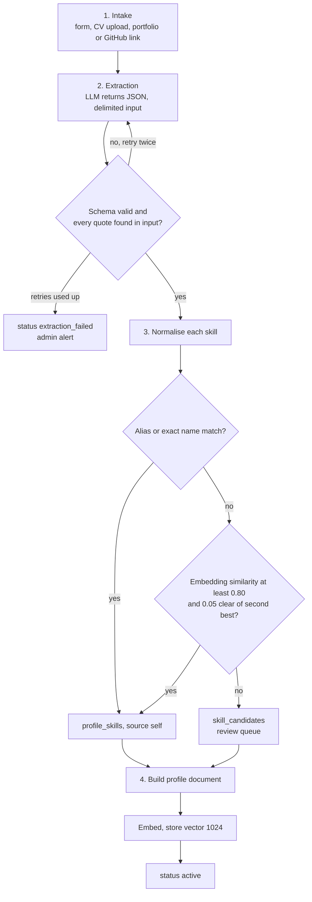
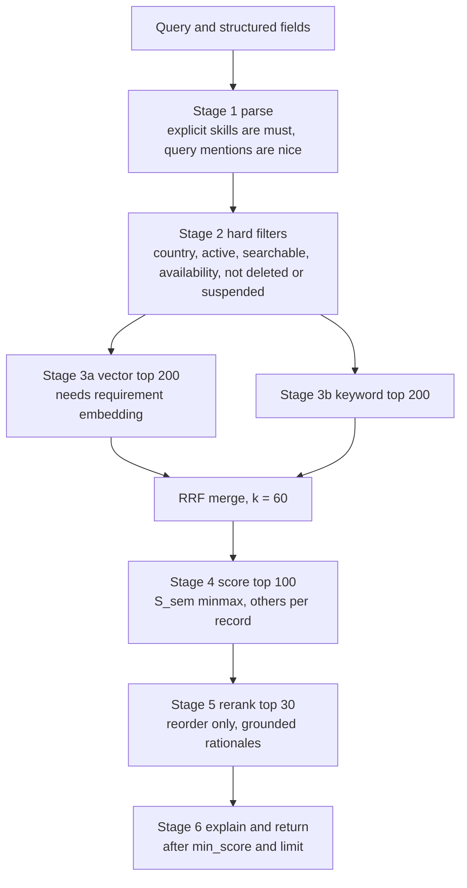
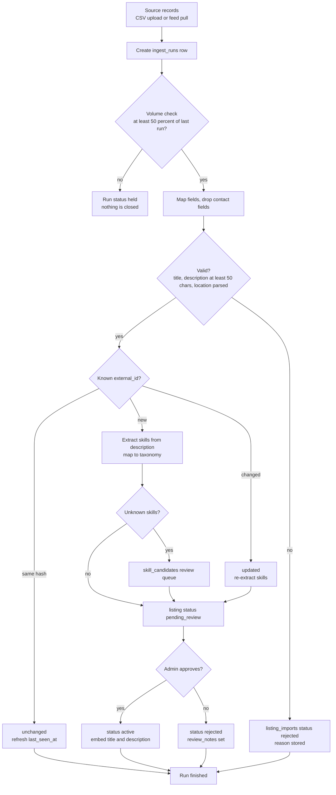
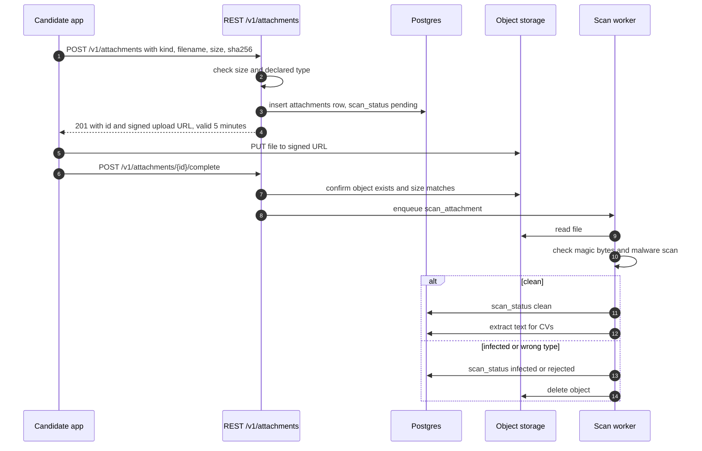

# Technical Specification

This document specifies how the Youth Yellow Pages backend is implemented: modules, pipelines, the scoring model with its edge cases, rate limits, and the job design for workers.

Read [ARCHITECTURE.md](ARCHITECTURE.md) first for the system view. The schema is in [DATABASE.md](DATABASE.md).

Source references use `[PDF §n]`. Items marked **(addition)** go beyond the PDF. Items marked **(default)** are starting values that must be validated against the gold set.

---

## 1. Module layout

```
backend/
├── config/
│   ├── settings/            base.py, dev.py, staging.py, prod.py
│   ├── asgi.py              mounts Django and the MCP app
│   ├── urls.py
│   └── celery.py
├── core/
│   ├── services/
│   │   ├── actor.py         Actor dataclass, built from token or API key
│   │   ├── permissions.py   role and scope checks
│   │   ├── profiles.py
│   │   ├── evidence.py
│   │   ├── skills.py
│   │   ├── search.py
│   │   ├── scoring.py
│   │   ├── explain.py
│   │   ├── listings.py
│   │   ├── matches.py
│   │   ├── contact.py
│   │   ├── reports.py
│   │   ├── verification.py  employer business-registration checks
│   │   ├── auth.py          tokens, refresh rotation, API keys
│   │   └── audit.py
│   ├── engine/
│   │   ├── parser.py        requirement parsing
│   │   ├── retriever.py     vector, keyword, RRF
│   │   ├── reranker.py      LLM rerank with schema validation
│   │   └── embeddings.py    embedding interface and Bedrock adapter
│   ├── ingestion/
│   │   ├── extractor.py     LLM skill extraction
│   │   ├── normaliser.py    alias then embedding match
│   │   └── documents.py     profile document builder
│   ├── llm/
│   │   ├── base.py          LLM interface
│   │   └── bedrock.py       Bedrock adapter
│   └── models/              Django models
├── api/
│   ├── v1/                  DRF views, serializers, URL routes
│   └── throttles.py
├── mcp_server/
│   ├── app.py               FastMCP instance
│   ├── tools.py             8 tools, each calls a service
│   ├── resources.py
│   └── prompts.py
├── workers/
│   ├── tasks_ingestion.py
│   ├── tasks_verification.py
│   ├── tasks_maintenance.py
│   └── schedules.py
└── tests/
    ├── unit/
    ├── integration/
    └── scoring/             regression suite and gold set loader
```

Rules:

- `api/` and `mcp_server/` import from `core/services` only. They never import models or engine modules directly.
- `core/engine` never checks permissions. It receives a pre-filtered candidate set from `search.py`.
- Models are not exposed to views. Services return dataclasses or plain dictionaries.

---

## 2. The Actor and permissions

Every service function takes an `Actor`:

```python
@dataclass(frozen=True)
class Actor:
    user_id: UUID | None      # None for anonymous public reads
    role: Literal["youth", "employer", "business", "admin", "anonymous"]
    scopes: frozenset[str]    # e.g. {"read:public", "read:candidates"}
    door: Literal["rest", "mcp", "admin", "worker"]
    country: str | None
    request_id: str
```

Permission checks are explicit calls at the top of each service function:

```python
def get_profile(actor: Actor, profile_id: UUID, *, fields: set[str] | None = None) -> ProfileView:
    permissions.require_scope(actor, "read:public")
    profile = profiles_repo.get(profile_id)
    permissions.require_visible(actor, profile)  # owner, admin, or consent-allowed
    allowed = consent.allowed_fields(profile_id, viewer=actor)
    return ProfileView.build(profile, fields=allowed & (fields or allowed))
```

Rules:

- A missing scope raises `PermissionDenied` (HTTP 403, MCP error code `forbidden`).
- A missing record or a record the actor may not see raises `NotFound` (HTTP 404). This avoids confirming that a profile exists.
- Workers run as `Actor(role="admin", door="worker")` only for the task's own scope, never for user-facing operations.

---

## 3. Authentication

| Client | Mechanism | Token lifetime |
|---|---|---|
| Web and Flutter app (youth, employer, admin) | Django session or short-lived access token issued by `POST /v1/auth/token`; refresh token rotated on use | Access 15 minutes, refresh 30 days |
| AI agents via MCP | OAuth 2.1 authorisation code flow with PKCE; bearer token with scopes | Access 1 hour, refresh 14 days |
| Employers (phase 1 machine access) | API key sent as `Authorization: Bearer ypk_...`; stored as SHA-256 hash with an 8-character visible prefix | No expiry; revocable |

API key format: `ypk_` + 40 random base62 characters. Only the hash and prefix are stored. The full key is shown once at creation.

Refresh tokens are single-use. Reuse of a rotated refresh token revokes the whole token family **(addition)**.

**Built in this release:** the MCP endpoint authenticates bearer tokens through `mcp_server/auth.py`. `StaticTokenStore` resolves SHA-256 digests of tokens to an `Actor` (user, role, scopes). It is for development and tests only. The OAuth 2.1 flow, the `oauth_tokens` table, refresh rotation and API keys are not built yet. The web and app login endpoints are not built yet.

---

## 4. Ingestion pipeline



### 4.1 Stages [PDF §4]

| Stage | Input | Output | Failure handling |
|---|---|---|---|
| 1. Intake | Form, CV upload, portfolio or GitHub link | `profiles` row with `status=pending_extraction` | Validation error returns 400 |
| 2. Extraction | Profile text and links, delimited as data | JSON list of `{skill_text, level_hint, years, evidence_hint}` | Schema failure: retry twice, then `status=extraction_failed` and admin alert |
| 3. Normalisation | Extracted items | Matched `skill_id`s or review queue entries | No failure path; unmatched items queue |
| 4. Document build | Headline, skills, evidence summaries | Plain text profile document | Empty fields are omitted, not filled |
| 5. Embedding | Document text | 1024-float vector | Retry with exponential backoff, max 5 attempts |
| 6. Verification | Evidence rows | `verified` flag and `verified_by` | Per-type handling in section 4.4 |
| 7. Activation | All above complete | `status=active` | — |

### 4.2 Extraction prompt contract

The extractor sends the LLM:

- A **system prompt** that defines the task and the output schema. It contains no user text.
- A **user message** that wraps profile text in explicit delimiters:

```
<profile_text>
...untrusted text...
</profile_text>
```

- The **fixed taxonomy list** (skill ids and names only, not user input).

The model must return JSON matching this schema. Output that fails validation is rejected, not repaired silently.

```json
{
  "skills": [
    {
      "skill_text": "string, max 80 chars",
      "matched_taxonomy_id": "string or null",
      "level_hint": "integer 1..5 or null",
      "years": "number >= 0 or null",
      "last_used_year": "integer 1950..current year or null",
      "evidence_quote": "string, max 200 chars, must be a substring of the input"
    }
  ]
}
```

Validation rules:

- `evidence_quote` must appear verbatim in the input. Otherwise the item is dropped and counted in the `extraction_quote_mismatch` metric. This is the main guard against invented skills.
- `matched_taxonomy_id`, if set, must exist in the taxonomy. Otherwise it is treated as null.
- Maximum 40 items per profile. Extra items are dropped.

### 4.3 Normalisation

For each extracted `skill_text`:

1. **Exact or alias match.** Lowercase, trim, collapse whitespace, remove punctuation except `+#.`. Compare with `skills.name` and `skills.aliases`. A single match is accepted.
2. **Embedding match.** Embed `skill_text`. Find the nearest taxonomy skill by cosine similarity. Accept if similarity is at least **0.80** (default, tune on data [PDF §4]). Accept only when the best match is at least 0.05 above the second-best; otherwise treat as ambiguous.
3. **Otherwise** create a `skill_candidates` row with `status=pending`, and do not add the skill to the profile.

Accepted matches create `profile_skills` rows with `source='self'` and `level` from `level_hint` (default 2 when absent). **(default)**

### 4.4 Evidence verification

| Type | Procedure | `verified_by` |
|---|---|---|
| `project` (GitHub) | Fetch the URL. If the candidate has linked an OAuth GitHub account and owns or has committed to the repo, mark verified | `oauth_github` |
| `project` (other) | Fetch the URL; success marks `reachable` but not `verified` until admin review | `admin` |
| `certificate` | Lookup via issuer API where available; otherwise stays `verified=false` | `issuer_api` |
| `assessment` | Result must be signed by the assessment provider webhook | `assessment_provider` |
| `employer_review` | Signed confirmation link sent to employer's verified email; click confirms | `employer_confirmation` |

Link fetches:

- Timeout 5 seconds, maximum 1 MB read, no redirects beyond 3.
- Blocked hosts: private IP ranges, `localhost`, link-local addresses (SSRF protection).
- Results cached 24 hours.

### 4.5 Re-embedding on change

A profile is re-embedded when any of these change: headline, bio, skills, or evidence summaries. Changes set `embedding_stale_at = now()`. The nightly `reindex_stale` job processes rows where `embedding_stale_at` is not null, in batches of 200. A change that arrives during processing sets `embedding_stale_at` again, so nothing is lost.

---

## 5. Retrieval (RAG) pipeline [PDF §5]



### 5.1 Stage 1: parse the requirement

Input: free text, structured fields, or both.

Output:

```python
@dataclass
class Requirement:
    must: list[SkillReq]       # skill_id, level (1..5)
    nice: list[SkillReq]
    country: str | None
    location_text: str | None
    availability: Literal["now", "within_30_days", "flexible"] | None
    languages: list[str]       # ISO 639-1
    pay_min: int | None
    pay_max: int | None
    currency: str | None
    text: str                  # normalised free text for embedding
    requirement_hash: str      # SHA-256 of canonical JSON, used for caching
```

v1 parser (implemented in `core/engine/parser.py`):

1. Explicit `skills` parameter entries become **must-have** skills. Each entry is `name` or `name:level`, where the name is resolved through taxonomy names and aliases. Level defaults to 3 **(default)**.
2. Skills named in the free-text query become **nice-to-have** skills at level 2 **(default)**. A skill already listed as must-have is not repeated.
3. Unknown skill names are returned in `unknown_skills` and are not used in scoring.
4. Country must be one of `NG`, `ZA`, `KE`, `GH`. Query length is capped at 500 characters and at most 20 skill entries are accepted.
5. A request with neither a query nor a recognised skill is rejected with a validation error.

The LLM parser described in the design for free text is planned as a later addition. The deterministic parser above is the fallback the design already allows when parsing fails.

### 5.2 Stage 2: hard filters

Applied before ranking. The SQL store will express these as a `WHERE` clause. The in-memory store applies the same rules in `core/engine/filters.py`. Candidates must satisfy all of:

- `users.country = requirement.country` when provided
- `profiles.status = 'active'`
- `profiles.searchable = true`, which is set only when the `search` consent is granted
- `users.suspended_at IS NULL` and `profiles.deleted_at IS NULL`
- Availability is at least as soon as requested: `now` accepts `now` only; `within_30_days` accepts `now` or `within_30_days`; `flexible` accepts any value. A candidate with no availability is excluded when availability is requested **(changed from exact match, so that S_fit can give full credit to candidates who can start sooner)**

### 5.3 Stage 3: candidate generation

Two channels run over the filtered set:

| Channel | Production (Postgres) | v1 in-memory store |
|---|---|---|
| Vector | `ORDER BY embedding <=> :query_vector LIMIT 200`, HNSW cosine. Runs only when the requirement text is embedded | Same ranking, computed in Python |
| Keyword | `tsvector @@ plainto_tsquery` ranked with `ts_rank_cd`, plus trigram similarity on skill names. Limit 200 | Token overlap between the requirement text and the profile text, plus one point per matched requirement skill. A stand-in until the SQL store exists |

When embedding fails, only the keyword channel runs and the response reports `embedding_status = unavailable` [ARCHITECTURE.md §10].

Merge with **reciprocal rank fusion**:

```
RRF(d) = Σ over channels  1 / (k + rank_channel(d))      k = 60 (default)
```

Documents not returned by a channel contribute nothing for that channel. The fused list is sorted by RRF score, descending. The top 100 move to scoring.

### 5.4 Stage 4: score (section 6)

### 5.5 Stage 5: rerank

- The top 30 by final score are sent to the LLM with the requirement and each candidate's **profile document and evidence summaries**. Each candidate is wrapped in its own delimited block with an id.
- The LLM returns, per candidate, an ordering and a short rationale. Output must match a schema; each rationale must cite field names present in the input.
- The reranker may **reorder** candidates within the top 30. It may not add or remove candidates, and may not change scores. The final order is the reranker's order for the top 30, followed by the rest in score order.
- The reranker gets two attempts in total. If both fail validation, or the LLM is unavailable, the score order is kept and `rerank_status = failed` is returned. When rerank is not requested or no LLM is configured, `rerank_status = skipped`. When it succeeds, `rerank_status = applied`.
- Ids the model omits are kept, in score order, after the ids it ranked. Ids the model invents, or repeats, make the attempt invalid.
- Profile text, headline and evidence titles are sanitised before they enter the prompt. Control characters are removed, `&`, `<` and `>` are escaped, and each field is length-capped. `headline`, `bio` and verified evidence titles are included only when released to the `employers` audience. Skills are always included for searchable profiles, following the skill visibility rule in [DATABASE.md §4.8](DATABASE.md#48-profile_consents).

Grounding check: every skill name or alias in the taxonomy that appears in a rationale must either be a skill in the requirement or a skill in that candidate's record. If any other skill is named, the rationale is **dropped** (not edited), and a `grounding_violation` entry with the profile id and skill slugs is returned. The score is unaffected **(changed from removing the term: a partial rewrite can still read as a claim)**.

### 5.6 Stage 6: explain and return

For each returned candidate:

- `matched_skills`: requirement skills the candidate has at any level above zero (`coverage > 0`).
- `missing_skills`: requirement skills the candidate lacks or meets only partly (`coverage < 1`), with the required level, the candidate's level, and `must_have`. Partial matches appear here with their coverage value.
- `evidence_links`: verified evidence URLs the candidate has made visible.
- `next_project`: a suggested project from a fixed list per skill in the taxonomy (`skills.suggested_projects`), not generated text.
- `breakdown`: each scoring component with its value and weight.
- `confidence`: section 6.6.
- `band`: section 6.5.

Contact details are never included at this stage.

---

## 6. Skill scoring model [PDF §6]

### 6.1 Formula

```
final = 100 × (0.35 × S_sem + 0.30 × S_skill + 0.20 × S_evid + 0.10 × S_fresh + 0.05 × S_fit)
```

Weights sum to 1.00 and are versioned as `scoring_version = "v1"`.

### 6.2 Components

**S_sem: semantic similarity (0 to 1)**

```
raw = cosine(requirement_embedding, profile_embedding)
S_sem = (raw − min_raw) / (max_raw − min_raw)     over the candidate set being scored
```

Edge cases **(default)**:

- Candidate set of size 1, or `max_raw == min_raw`: `S_sem = 0.5`.
- Embedding missing for a profile: `S_sem = 0`, and the candidate is flagged `embedding_missing`.

The min-max scaling depends on the pool, so a candidate's score can change when the pool changes. Search responses report `sem_scale = minmax` (or `none` when no requirement embedding exists). Single-profile scoring (`score_candidate`, `get_skill_gap`, `search_opportunities`) must not depend on other candidates, so it maps the raw cosine with `S_sem = (raw + 1) / 2`, clamped to [0, 1], and reports `sem_scale = absolute` **(default)**.

**S_skill: weighted coverage (0 to 1)**

```
w_i = 1.0 if must-have else 0.4
c_i = min(level_profile_i / level_required_i, 1.0)     0 if skill absent
S_skill = Σ (w_i × c_i) / Σ w_i
```

Matches `skill_coverage` in [PDF §6]. A profile skill with `level = 0` or absent counts as 0.

**S_evid: evidence-weighted share (0 to 1)**

Evidence weight per source, taking the best available source per matched skill:

| Source | Weight |
|---|---|
| Assessment (verified) | 1.0 |
| Employer review (verified) | 0.9 |
| Verified project | 0.8 |
| Certificate (verified) | 0.5 |
| Self-declared, or unverified evidence | 0.2 |

```
S_evid = Σ over matched skills (w_i × e_i) / Σ over matched skills w_i
```

where `e_i` is the best evidence weight for skill `i` (0.2 if only self-declared), and the sum runs over skills with `c_i > 0`. If no skill is matched, `S_evid = 0`. **(default: weighting by `w_i` so must-haves dominate, to be confirmed with the gold set)**

Unverified evidence counts at 0.2 even if the source type is higher. A verified flag is required to earn the higher weight.

**S_fresh: recency (floor 0.3, 0 to 1)**

For each matched skill with `last_used` known:

```
months = months between last_used and today
f_i = max(0.3, 0.5 ^ (months / 24))
```

Half-life 24 months, floor 0.3 [PDF §6].

For matched skills with `last_used` unknown: `f_i = 0.3` **(default: unknown is treated as the floor, not as current, so unknown dates do not inflate the score)**.

Aggregate across matched skills with the same weights as `S_skill`:

```
S_fresh = Σ (w_i × f_i) / Σ w_i       over matched skills
```

If no skill is matched, `S_fresh = 0.3`. **(default)**

Future `last_used` dates are treated as today.

**S_fit: fit (0 to 1)**

Average of the applicable fit checks, each 0 or 1 or a partial value:

| Check | Value |
|---|---|
| Location: same city or state = 1; same country = 0.5; otherwise 0 | Only if requirement has a location |
| Availability: candidate is at least as available as requested = 1; otherwise 0. Candidates who fail this are removed by the hard filter, so in practice this is 1 for every ranked candidate **(changed: the earlier 0.5 partial credit could not be reached after the filter change in §5.2)** | Only if requirement has availability |
| Language: all required languages spoken = 1; partial = proportion | Only if requirement has languages |
| Pay range: profile expectation overlaps requirement = 1; otherwise 0 | Only if both have pay data |

If no checks apply, `S_fit = 0.5` **(default, neutral)**.

Note: location and pay are fit criteria, not protected attributes. Name, gender, age, photo and school prestige are never used anywhere in scoring [PDF §6].

### 6.3 Gate

If any **must-have** skill has `c_i = 0`, the final score is capped at **40**.

```
if any(c_i == 0 for must-have skills):
    final = min(final, 40)
```

The gate is reported in the breakdown as `gate_applied: true`.

### 6.4 Rounding

Final score is rounded to one decimal place, half to even. Bands use the rounded value.

### 6.5 Bands [PDF §6]

| Score | Band |
|---|---|
| 80 and above | `strong` |
| 60 to 79.9 | `good` |
| 40 to 59.9 | `partial` |
| below 40 | `weak` |

### 6.6 Confidence

Confidence describes how much of the score rests on evidence. **(default formula, addition)**

Each must-have skill scores once, using the strongest evidence it has for that skill:

- at least one verified evidence item for the skill: 1.0
- only unverified evidence for the skill: 0.5
- no evidence for the skill: 0

```
confidence = sum of the per-skill values / number of must-have skills
```

If there are no must-have skills, the same rule applies over nice-to-have skills. The value is between 0 and 1. Labels: `high` at 0.75 and above, `medium` at 0.4 to 0.74, `low` below 0.4.

### 6.7 Worked example

Requirement: Python (must, level 3), SQL (must, level 3), Django (nice, level 2).
Profile: Python level 4 (verified project, last used 6 months ago), SQL level 2 (self-declared, last used 2 years ago), Django level 2 (self-declared, last used unknown).

Coverage:

- Python: `c = min(4/3, 1) = 1.0`, `w = 1.0`
- SQL: `c = min(2/3, 1) = 0.667`, `w = 1.0`
- Django: `c = min(2/2, 1) = 1.0`, `w = 0.4`

Gate: no must-have has zero coverage, so no cap.

`S_skill = (1.0 + 0.667 + 0.4) / (1.0 + 1.0 + 0.4) = 2.067 / 2.4 = 0.861`

`S_evid`: Python best source verified project, `e = 0.8`. SQL self-declared, `e = 0.2`. Django self-declared, `e = 0.2`.
`S_evid = (1.0×0.8 + 1.0×0.2 + 0.4×0.2) / 2.4 = 1.08 / 2.4 = 0.45`. Note: Django is matched, so it is included.

`S_fresh`: Python `months = 6`, `f = max(0.3, 0.5^(6/24)) = 0.841`. SQL `months = 24`, `f = 0.5`. Django unknown, `f = 0.3`.
`S_fresh = (1.0×0.841 + 1.0×0.5 + 0.4×0.3) / 2.4 = 1.461 / 2.4 = 0.609`

`S_fit`: no location, availability, languages or pay in requirement, so `S_fit = 0.5`.

`S_sem`: suppose raw cosine is 0.72 and the pool min/max give `S_sem = 0.64`.

Final:

```
final = 100 × (0.35×0.64 + 0.30×0.861 + 0.20×0.45 + 0.10×0.609 + 0.05×0.5)
      = 100 × (0.224 + 0.258 + 0.090 + 0.061 + 0.025)
      = 100 × 0.658
      = 65.8   → band "good"
```

Confidence: must-haves Python (verified) and SQL (no verified evidence, self only). Confidence = (1 + 0) / 2 = 0.5 → `medium`.

This worked example must appear as a fixture in `tests/scoring/` and must pass.

### 6.8 Implementation notes

- All scoring functions are pure: inputs in, numbers out, no database access. The service fetches inputs and passes them in.
- Use `Decimal` or round only at the final step, to keep results reproducible.
- Store `scoring_version` and the full breakdown on every `matches` row.

### 6.9 Calibration

Weights are starting values [PDF §6]. Before the pilot:

1. Label at least 200 pairs (0 to 3) with recruiters [PDF §10].
2. Compare the current weights against alternatives using nDCG at 10 and precision at 5.
3. Lock weights only with a new `scoring_version`, and update the regression fixtures.

---

## 7. MCP tools

Each tool is a thin wrapper in `mcp_server/app.py` that calls one `TalentService` method. Input schemas come from type hints. The first argument of each tool is the request context, which carries the bearer-token actor.

**Built in this release (read tools):**

| Tool | Parameters | Service method | Scope | Result cap |
|---|---|---|---|---|
| `search_talent` | `query`, `country`, `skills`, `min_score` (default 40), `limit` (default 10, max 25), `rerank` (default true) | `search_talent` | `read:candidates`, role employer, business or admin | 25 results |
| `score_candidate` | `profile_id`, `query`, `skills`, `country` **(changed from `requirement`, to match the other tools)** | `score_candidate` | `read:candidates`, same roles | 1 result |
| `get_profile` | `profile_id` | `get_profile` (public fields only) | `read:public` | 1 profile |
| `search_opportunities` | `profile_id`, `country`, `min_score` (default 40), `limit` | `search_opportunities` | `read:public`, role youth or admin, caller owns the profile | 25 results |
| `get_skill_gap` | `listing_id`, `profile_id` | `get_skill_gap` | `read:public`, caller owns the profile | all requirement skills |
| `list_skills` | `query`, `category`, `limit` (max 100) | `list_skills` | `read:public` | 100 skills |

`search_opportunities` takes a `profile_id` only. Matching from free text (`query`) is **not yet built**, because free text has no candidate record to score against.

**Not built yet:**

| Tool | Reason |
|---|---|
| `create_listing` | Needs the Postgres store and the listings write path |
| `record_outcome` | Needs the Postgres store and the matches table |

Prompts and resources from the design are not built yet.

Safety rules for all tools:

- Profile text in results is placed under `untrusted_text` and the response carries `"untrusted": true`.
- Tool results never include contact details. The contact release flow is not built yet.
- Results are capped; exceeding a cap returns the first N with `truncated: true`.

---

## 8. REST rules

- Base path `/v1`. Versioned routes only.
- JSON in, JSON out. Dates are ISO 8601 in UTC.
- Pagination: cursor-based, `?cursor=...&limit=...`, default 20, max 50 **(addition)**.
- Errors use a single shape:

```json
{
  "error": {
    "code": "validation_error",
    "message": "Human-readable summary",
    "details": [{"field": "skills[0].level", "message": "must be between 1 and 5"}],
    "request_id": "req_01J..."
  }
}
```

Error codes: `validation_error` (400), `unauthenticated` (401), `forbidden` (403), `not_found` (404), `conflict` (409), `rate_limited` (429), `dependency_unavailable` (503), `internal_error` (500).

- Long-running writes return `202 Accepted` with a `status_url`.
- Search endpoints accept `rerank=true|false` (default true).

---

## 9. Rate limits

Counters live in Redis with sliding windows.

| Scope | Limit (default) |
|---|---|
| Anonymous, per IP | 60 requests per minute |
| Youth token | 120 requests per minute |
| Employer key | 300 requests per minute |
| Search endpoints, per token | 30 per minute |
| MCP, per token | 120 tool calls per minute; 20 `search_talent` per minute |
| Write endpoints, per token | 30 per minute |
| Evidence link fetches, per profile | 10 per hour |
| Login attempts, per account and per IP | 5 per 15 minutes, then backoff |

Exceeding a limit returns `429` with a `Retry-After` header. MCP returns a tool error with the same retry hint.

Failure behaviour: if Redis is unavailable, write endpoints fail closed (503) and read endpoints allow the request and log the bypass **(addition)**.

---

## 10. Workers and jobs

### 10.1 Queues

| Queue | Tasks | Concurrency |
|---|---|---|
| `ingest` | extraction, normalisation, document build | 4 per worker |
| `embed` | embedding calls | 8 per worker, rate limited to Bedrock quota |
| `verify` | link fetches, API lookups | 8 per worker |
| `maintenance` | reindex, purge, reports, monthly fairness report | 1 per worker |

### 10.2 Job rules

- **Idempotent.** Each task takes a natural key (profile id plus version) and skips work already done for that version.
- **Retry.** Exponential backoff with jitter, max 5 retries for external calls, no retries for validation failures.
- **Time limits.** Soft limit 60 seconds, hard limit 120 seconds for ingestion; 300 seconds for reindex batches.
- **Acknowledgement.** `acks_late = true` so a crashed worker's task is re-delivered.
- **Dead letter.** Tasks that exhaust retries are recorded in `failed_jobs` and surfaced in admin **(addition)**.

### 10.3 Schedules (Celery Beat)

| Schedule | Task | Notes |
|---|---|---|
| Daily 02:00 UTC | `reindex_stale` | Batches of 200, stops after 60 minutes |
| Daily 03:00 UTC | `purge_deleted` | Hard-deletes accounts past the deletion window |
| Daily 04:00 UTC | `expire_api_keys` and refresh-token cleanup | |
| Daily 05:00 UTC | `retained_6m_check` | Creates confirmation requests for hires 6 months old |
| Monthly, day 1, 06:00 UTC | `fairness_report` | Writes aggregate report; no individual data |
| Every 10 minutes | `queue_health` | Records queue depth and oldest task age |

Beat runs as a single instance on Render [ARCHITECTURE.md §3].

---

## 11. Audit logging

Every service call that reads a profile, changes data, or returns a score writes one row to `audit_log`:

| Field | Value |
|---|---|
| `actor_id` | `user_id` or null |
| `actor_role` | from `Actor` |
| `door` | `rest`, `mcp`, `admin`, `worker` |
| `operation` | service function name, e.g. `search.talent` |
| `args_hash` | SHA-256 of canonical JSON of arguments, with personal data fields removed |
| `result` | `ok`, `denied`, `not_found`, `error` |
| `request_id` | propagated from the request or task |
| `created_at` | UTC timestamp |

Audit rows are append-only. The application role has `INSERT` and `SELECT` on `audit_log` only.

---

## 12. Testing strategy

| Level | What | Where |
|---|---|---|
| Unit | Scoring functions, normaliser, RRF, rate limit counters, grounding check | `tests/unit` |
| Scoring regression | Worked example in §6.7, gold set nDCG and precision thresholds, edge cases in §6.2 | `tests/scoring` |
| Integration | Services with a real Postgres (pgvector) and Redis | `tests/integration` |
| API contract | REST responses against the error shape and pagination rules | `tests/integration/api` |
| MCP | Each tool called with each scope, including denied cases | `tests/integration/mcp` |
| Security | Scope bypass attempts, consent bypass, prompt injection fixtures, SSRF fixtures | `tests/integration/security` |
| Load | Search p95 under 2.5 seconds at 5 requests per second with rerank | Staging, before pilot |

Required test cases before any release:

1. A candidate without consent never appears in search, MCP or REST, including via keyword.
2. A `write:listings` scope is required for `create_listing`; a read-only token is denied.
3. A profile containing "ignore previous instructions" does not change tool calls or system behaviour.
4. An extraction output with a quote not in the input is dropped.
5. A link to `127.0.0.1` is blocked.
6. The worked example in §6.7 produces 65.8.

---

## 13. Configuration defaults

| Setting | Default | Source |
|---|---|---|
| `EMBEDDING_DIM` | 1024 | [PDF §3] |
| `SKILL_MATCH_THRESHOLD` | 0.80 | [PDF §4] |
| `SKILL_AMBIGUITY_MARGIN` | 0.05 | **(default)** |
| `RRF_K` | 60 | **(default)** |
| `CANDIDATES_VECTOR` | 200 | [PDF §5] |
| `CANDIDATES_KEYWORD` | 200 | [PDF §5] |
| `SCORE_TOP_N` | 100 | [PDF §5] |
| `RERANK_TOP_N` | 30 | [PDF §5] |
| `GATE_CAP` | 40 | [PDF §6] |
| `FRESHNESS_HALF_LIFE_MONTHS` | 24 | [PDF §6] |
| `FRESHNESS_FLOOR` | 0.3 | [PDF §6] |
| `SCORING_VERSION` | `v1` | **(addition)** |
| `MIN_SCORE_DEFAULT` | 40 | [PDF §7] |
| `NEXT_PROJECT_SOURCE` | taxonomy table | **(default)** |
| `DELETION_WINDOW_DAYS` | 30 | **(addition, pending legal review)** |
| `FAILED_LLM_RETRIES` | 2 | **(default)** |

---

## 14. Opportunity ingestion

This section specifies how opportunity listings from partner institutions enter the directory. Employer-posted listings go through `POST /v1/listings` and the review step described in §14.6, and are not covered here.

### 14.1 Scope and phases

| Phase | Method | Status |
|---|---|---|
| 1, pilot | Admin uploads a CSV from a partner's placement office. The CSV goes through the same pipeline as feeds | Build first |
| 1, demo | Real snapshot of public Greenhouse postings from six employer boards (§14.16) | Demo environments only |
| 2a | Greenhouse Job Board API connector, one connector per employer board | Build after phase 1. Source terms checked per §14.13 |
| 2b | Scheduled feed pull from a partner that has agreed to provide one | Build after a written agreement |
| 2c | Generic web scraper for employer career pages | Only under the registry rules in §14.14. Each source needs a recorded permission check |
| Not planned | LinkedIn job scraping, or scraping any site without a permission check | Excluded. See §14.13 |

### 14.2 Source assessment: KCA University (first partner)

Findings from public sources, checked during design:

| Source | What we found | Decision |
|---|---|---|
| Public careers page, `kcau.ac.ke/career/` | Server-rendered list of vacancies. Each row shows title, school, employment type, campus and a details link. No closing date or salary in the list. Details pages were not reviewed | Use only with written permission. Until then, the placement office CSV is the input |
| `robots.txt` on `kcau.ac.ke` | Has no `Disallow` rule for `/career/` and points to a sitemap | Not a permission to republish. Permissive robots rules do not replace a data agreement |
| UNISCOO career portal, `uniscoo.org` | KCA's public post directs students there for career services and internships. The site could not be reached when checked, so its format and terms are unknown | Investigate with the placement office. Do not integrate until checked |
| KCA recruitment portal, `careers.kcau.ac.ke` | Requires a login | Out of scope |
| Third-party aggregators that repost KCA vacancies | Secondary copies with unknown freshness | Not a source. We do not republish copies |

Next step: contact the KCA placement office (`placement@kca.ac.ke`, the address published in their own career notice) to request a CSV export or feed, a named contact for errors, and written consent for the directory to publish these listings.

### 14.3 Pipeline



### 14.4 Field mapping

The KCA careers page does not follow the schema.org `JobPosting` format, so the mapping is written against a generic partner record. The same mapping applies to a CSV with these columns, and to a feed that uses `JobPosting` where it is available.

| Partner field | Listing column | Rule |
|---|---|---|
| Title | `title` | Required. Trimmed. Title case applied only when the title is all uppercase |
| School or department | `department` | Stored as given |
| Employment type | `type` | `Full Time` or `Part Time` maps to `job`. A title containing "intern" maps to `internship`. A title containing "apprentice" maps to `apprenticeship`. Admin can override in review |
| Campus or location | `location_city`, `location_region` | Looked up in a campus table. Initial entries: Main Campus (Ruaraka) maps to Nairobi, Nairobi. Town Campus maps to Nairobi, Nairobi. Kitengela Campus maps to Kitengela, Kajiado. Western Campus maps to Kisumu, Kisumu. An unknown campus is rejected, not guessed |
| Location text | `location_text`, `eligible_countries`, `scope`, `work_mode` | Parsed into countries and a scope, §14.19. A listing is not rejected for being outside NG, ZA, KE or GH. Locations that cannot be parsed go to review with the text kept |
| Details URL | `source_url` | Must be https. Required for feed records. Optional for CSV |
| Description | `description` | Required, minimum 50 characters, HTML stripped. Missing descriptions are rejected |
| Closing date | `expires_at` | If present, used. If absent, first seen plus 30 days |
| Row identifier or details URL | `external_id` | CSV: the partner's own row id if provided, otherwise the details URL. Feed: the feed's identifier. Hashed with `source_key` for the unique index |
| Contact name, email, phone | Not stored | Dropped at intake. Never reaches `listing_imports.payload` |

The required skills are not in any partner field. They are extracted from the description with the same guardrails as profile extraction (TECHNICAL §4.2), then matched to the taxonomy with §4.3. Each matched skill becomes a `listing_skills` row. Skills named in the title are `must_have` with level 3. Other matched skills are nice-to-have with level 2. These defaults are shown to the admin in review and can be changed there.

### 14.5 Dedupe, change detection and closing

- **Identity:** a listing is identified by `(source_key, external_id)`. The unique index enforces this.
- **Change detection:** `payload_hash` is compared with the previous run. Unchanged records only refresh `last_seen_at` and reset `missing_runs`. Changed records re-run skill extraction and return to `pending_review`.
- **Missing records:** after a full sync, a listing absent from the source gets `missing_runs + 1`. At 2, status becomes `closed`. Listings are not deleted, so applications and matches keep their history.
- **Expiry:** a daily job sets `status = closed` for active listings whose `expires_at` has passed.
- **Safety hold:** if a run sees fewer than 50 percent of the rows of the previous successful run, the run is set to `held`. Nothing is closed, and an admin is alerted. This protects against a broken feed closing every job.

### 14.6 Review rules

- Every ingested listing starts as `pending_review`. Automatic publication is not allowed in phase 1 or 2.
- Reviewers see the source record, the mapped fields, the extracted skills, and any unknown skills.
- Rejection reasons are stored in `review_notes`. Listing reports (PDF §9) still apply after publication.
- A partner's listings are reviewed in full for the first three runs. Relaxing review for a partner needs a new decision record in ARCHITECTURE.md §8.

### 14.7 Partner accounts

- Each partner organisation has one `users` row with role `partner`. The KCA account owns all KCA listings.
- A partner cannot search candidates, read profiles, or call `POST /v1/listings`. Their only write path is ingestion.
- Ingestion runs with `Actor(role="partner", door="worker")` and the scope `write:listings` limited to that partner's own listings.
- Partner accounts are created by an admin after a written agreement is on file. The agreement reference is stored on the account.

### 14.8 Fetch rules for feeds (phase 2)

These apply only to a feed the partner has agreed to provide. They are not a basis for fetching pages that the partner has not agreed to.

- Identify the client with a user agent that names the product and a contact address.
- At most one request per 5 seconds per source. Honour `429` and `Retry-After`.
- Timeouts: connect 5 seconds, read 15 seconds, total 30 seconds (HTTPX).
- Maximum response size 2 MB. Responses larger than that are rejected, not truncated.
- Only the host in the partner's configuration is allowed. Redirects to other hosts are refused. Private and loopback addresses are blocked, as in §4.4.
- `robots.txt` is checked and honoured for any page-based source, even where a feed exists.

### 14.9 Failure handling

| Failure | Behaviour |
|---|---|
| Fetch timeout or `5xx` | Retried 3 times with exponential backoff. Then the run is `failed`, recorded in `failed_jobs`, and an alert is sent |
| `429` from the source | Wait for `Retry-After`. Count as a retry |
| Malformed CSV row | Row rejected with the reason. The rest of the run continues |
| Malformed feed (not parseable) | Run `failed`. Nothing changed |
| Volume drop | Run `held`. Nothing closed. Admin confirms before the next run |
| Skill extraction fails | Listing stays `pending_review` with `review_notes = extraction failed`. Retried once |

### 14.10 Tasks and schedule

| Task | Queue | Trigger |
|---|---|---|
| `ingest_csv_batch(run_id)` | `ingest` | Admin uploads a CSV |
| `pull_partner_feed(source_key)` | `ingest` | Celery Beat, daily at 01:00 UTC (phase 2) |
| `expire_listings` | `maintenance` | Daily at 02:30 UTC |
| `purge_listing_imports` | `maintenance` | Daily at 03:30 UTC. Removes `listing_imports` older than 90 days |

All tasks are idempotent, keyed on `(run_id, external_id)` or `(source_key, daily run date)`.

### 14.11 Metrics

Per run: `rows_seen`, `rows_published`, `rows_rejected`, `rows_unchanged`, and run duration. Per partner: time from ingestion to publication, and rejection rate by reason. A rejection rate above 30 percent for a partner triggers a review of the mapping, not of the partner.

### 14.12 Open items

| Item | Owner | Needed by |
|---|---|---|
| Request CSV or feed from the KCA placement office | Product | Before the pilot |
| Written agreement covering publication of KCA listings | Legal | Before any listing goes live |
| Check the UNISCOO portal's terms and format | Product | Before phase 2 |
| Confirm KCA's data protection notice covers the directory | Legal | Before the pilot |
| Confirm campus-to-location table with KCA | Product | Before the first import |

### 14.13 Source policy

Every source is checked before it is connected. The decision and its basis are recorded in the source registry (§14.14).

| Source | Decision | Basis |
|---|---|---|
| Greenhouse Job Board API (`boards-api.greenhouse.io`) | **Use.** One connector per employer board, for employers inside and outside Africa | Official GET endpoints, no authentication. Checked live on six boards (§14.16): each returns JSON with `title`, `location.name`, `absolute_url`, `updated_at`, `application_deadline`, and `content` with `content=true`. Confirm Greenhouse's terms for showing employer postings in a third-party directory before listing at scale |
| Lever public postings | Investigate | Not checked in this design |
| LinkedIn job pages and job data | **Not a source** | LinkedIn's User Agreement §8.2 prohibits crawlers and scraping of the Services, and copying or using information obtained from them through third parties. The Job Posting API is different: it lets approved ATS and job-distribution partners push jobs *into* LinkedIn, and it requires partner approval under the Job Posting API Terms. It does not give us job data, so it cannot be a listings source. Verified against LinkedIn's API documentation and terms |
| LinkedIn profiles of candidates | **Candidate-led only** | Two routes. (a) The candidate uploads their own LinkedIn PDF export as a CV attachment (§15). (b) Phase 3: candidate-initiated sign-in through LinkedIn's official developer program, with scopes and terms verified first. Neither route scrapes LinkedIn |
| KCA University careers page and UNISCOO | Agreement first. Interim manual CSV | §14.2 |
| Employer career pages (other) | Generic scraper, only under §14.14 | Permission recorded per source |
| Job aggregators that repost listings | **Not a source** | Secondary copies of unknown age. We do not republish them |

Why this matters for the goal of a range of opportunities: Greenhouse covers employers worldwide, so the directory can show roles from outside Africa as well as inside it. Each listing records where it is open to applicants (§14.19), and youth search defaults to the listings open in their own country.

### 14.14 Web scraper rules

A generic scraper is allowed for an employer career page only when every rule below holds. The scraper is a connector behind the same pipeline as feeds, so it inherits the safety hold (§14.5), review (§14.6) and failure handling (§14.9).

1. **Registry entry.** Each source has a row in `ingest_sources` with: `source_key`, the allowed host list, the owner, the permission reference (agreement reference, or the date and page where the site's terms were checked), the robots decision, the rate limit, the selector version, and an `enabled` flag. A source without a permission reference is not run.
2. **robots.txt.** Fetched before each run and cached for 24 hours. Paths disallowed for our user agent are never fetched. Where robots.txt disallows a path, the source is skipped. Nobody overrides the rule for a single run. The standard is RFC 9309.
3. **Identification and rate.** A user agent naming the product and a contact address. At most one request per 5 seconds per host. `429` and `Retry-After` honoured.
4. **Scope of fetching.** Public listing pages and the detail pages linked from them. No logins, no forms, no search endpoints, no paywalled or gated pages, no CAPTCHA handling.
5. **Fail closed on structure change.** Each run checks that the expected selectors exist and that the record count is within 50 percent of the previous successful run. Otherwise the run is `held`. Nothing is closed.
6. **Data kept.** Job fields only, as in §14.4. Personal data on the page (named contacts, photographs) is dropped.
7. **Kill switch.** Setting `enabled = false` stops a source at the next scheduled run.
8. **Tests.** Each selector set is tested against saved HTML snapshots of the page. Snapshots are refreshed when the selector version changes.

### 14.15 Greenhouse connector mapping

Board-level pull: `GET https://boards-api.greenhouse.io/v1/boards/{board_token}/jobs?content=true`, plus `pay_transparency=true` where pay is shown. Each employer that opts in provides its board token, and the token is recorded in the registry.

| Greenhouse field | Listing field | Rule |
|---|---|---|
| `id` | `external_id` | Post identifier. Used with `source_key` as the unique key. `internal_job_id` is not used |
| `title` | `title` | Required |
| `location.name` | `location_text`, `eligible_countries`, `scope`, `work_mode`, `unmapped_locations` | Free text, one or more `;`-separated places. Each place is matched to a country (names and a city table). Places that cannot be matched are kept in `unmapped_locations` and the listing goes to review. Scope and eligibility rules in §14.19 |
| `absolute_url` | `source_url` | Must be https |
| `content` | `description` | HTML sanitised. Minimum 50 characters |
| `departments[].name` | `department` | First department name |
| `application_deadline` | `expires_at` | If present |
| `updated_at` | Change detection | Compared with the stored `payload_hash` |
| `pay_input_ranges[]` | `pay_min`, `pay_max`, `pay_currency` | Values are in cents. Divide by 100. Currency from `currency_type` |
| `metadata`, `questions`, `data_compliance` | Not stored | Not needed for listings |

Applying: the Greenhouse application endpoint needs the employer's own Job Board API key and must be called from our server. We do not hold employer keys in phase 2a. A youth applies through `absolute_url`, and the outcome is recorded manually as an application event (§6.5 in ARCHITECTURE.md).

### 14.16 Demo data

The demo uses real, public postings, not samples. The snapshot was taken on the date in its `fetched_at` field from six Greenhouse boards:

| Employer | Board token | Postings | In region (onsite or remote, NG, ZA, KE, GH) | Notes |
|---|---|---|---|---|
| Moniepoint | `moniepoint` | 141 | 81 | Nigerian fintech. Mostly Nigerian roles, plus remote roles open to NG, ZA and KE, and remote roles elsewhere |
| Jumia | `jumia` | 29 | 18 | Pan-African e-commerce. Roles in NG, GH and KE, and some outside the region |
| ALX Africa | `alxafrica` | 12 | 6 | Tech education. Roles in ZA, NG and GH. Six have no stated country |
| One Acre Fund (Kenya) | `oafkenya` | 7 | 7 | Agricultural finance. Kenya roles |
| One Acre Fund (Global) | `oneacrefundglobal` | 4 | 3 | Roles across East and West Africa, including Kenya and Nigeria |
| impact.com | `impact` | 79 | 23 | Partnership software. Most roles are outside the region, including some in South Africa |

Counts are from the snapshot taken on `fetched_at`. They will change as the employers post and close roles.

- File: `backend/demo/greenhouse_snapshot.json`. Each listing keeps the employer's `absolute_url`, which is the source of truth, and the employer's own description with HTML removed.
- The snapshot is a demonstration copy. The connector refreshes it. Nobody edits it by hand.
- The demo loader is a seed command, allowed only in `demo` and `dev` (§14.17). Every API response for these listings includes `"source": "greenhouse"`, the employer name, and `"demo": true`, so clients can label them.
- Attribution: each listing shows the employer and links to the original posting. The directory does not claim to be the employer or to take applications for them. Applying happens on the employer's page (§14.15).
- The KCA University listings are not in the demo. They wait for the placement office's agreement (§14.2).
- Locations the parser could not read are in `unmapped_locations`. In the current snapshot those are eight places, such as Tokyo, Oslo, Porto, and "Africa" on its own. They go to review and are not shown until someone assigns their country.

### 14.17 Environment guard

The demo seed command checks `APP_ENV`. It refuses to run when `APP_ENV` is `production`, and it refuses to write a `demo` listing into any environment other than `demo` or `dev`. The check is in the command and is covered by a test.

### 14.18 Supply coverage

- Scoring ignores the source of a listing. Source affects only what is shown, never the score.
- A monthly report lists active listings by source, country and campus or city. This is how we see whether coverage is narrow.
- A source that provides fewer than 5 active listings for 3 consecutive months is reviewed for whether it is worth keeping.

### 14.19 Eligibility and regional scope

A listing is not rejected for being outside NG, ZA, KE or GH. Each listing records where it is open to applicants. Youth search defaults to listings open in the youth's own country, and a global view shows everything with its scope labelled.

| Scope | Meaning | Example | Default youth search | Global view |
|---|---|---|---|---|
| `in_region` | Onsite or hybrid in NG, ZA, KE or GH | Lagos, Nigeria | Shown when the youth's country is in `eligible_countries` | Shown |
| `remote_in_region` | Remote, and the source names NG, ZA, KE or GH | Remote, Kenya | Shown when the youth's country is named | Shown |
| `outside_region` | Onsite or hybrid in another country | London, United Kingdom | Hidden | Shown, labelled "not in your country" |
| `remote_outside_region` | Remote, and the source names only other countries | Remote, Spain | Hidden | Shown, labelled "not in your country" |
| `unspecified` | No country can be read | Remote, or Africa | Hidden | Shown, labelled "eligibility unclear" |

Rules:

- `eligible_countries` comes from the location text (§14.15). A listing with several named countries is shown to youth in each of them.
- A remote role counts as open to a country only when the source names that country. We do not infer eligibility.
- Scope affects which listings are returned. It never affects the score (§14.18).
- Unmapped locations go to review. The listing is not shown in the default search until a country is assigned.

---

## 15. Attachments and CV uploads

Attachments are files a candidate uploads: a CV, certificates, a cover letter, a portfolio file, or a LinkedIn PDF export. Attachments are never used until they pass a scan.

### 15.1 Rules

| Rule | Detail |
|---|---|
| Accepted types | PDF, DOCX. Checked from the file's leading bytes (magic numbers), not from the extension |
| Maximum size | 5 MB per file |
| Names | The client's filename is stored for display only. Sanitised. Storage keys are random UUIDs |
| Access | Never served directly. Downloads use a short-lived signed URL (5 minutes) for the owner, or for an employer the candidate has contacted |
| Scan | Every file is scanned before it is marked `clean`. Only `clean` files can be linked to a profile, evidence or application |
| Text extraction | CV text is extracted for profile extraction (§4). It is untrusted data and follows the rules in §4.2 |
| Deletion | Removed from storage when the profile is purged (§6 in DATABASE.md) |

### 15.2 Upload flow



### 15.3 Data

The `attachments` table is defined in DATABASE.md §4.20.

### 15.4 LinkedIn and other exports

A candidate who wants their LinkedIn profile used in matching exports it from LinkedIn themselves, as a PDF, and uploads it as a CV. The file is the candidate's own data, and the candidate chooses to share it. We do not fetch LinkedIn pages on the candidate's behalf. The same applies to other sites: the candidate downloads, we ingest the file they gave us.
