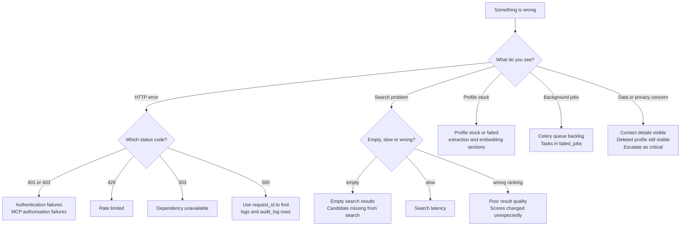

# Troubleshooting

This guide is organised by symptom. Find what you see, follow the checks in order, then apply the fix. Each section names the component it concerns, so you can jump to the right design document.

- Architecture: [ARCHITECTURE.md](ARCHITECTURE.md)
- Implementation: [TECHNICAL.md](TECHNICAL.md)
- Schema: [DATABASE.md](DATABASE.md)

Commands assume the Render shell or a local shell in `backend/`. Replace `$DATABASE_URL` as needed. Management commands and task names shown here are the planned interfaces from [TECHNICAL.md](TECHNICAL.md); they exist once the backend is built.

## How to use this guide

1. Identify the symptom in the index below.
2. Check the first step first. Do not skip to fixes.
3. Use the request id (`request_id`, returned in every error body) to find the matching `audit_log` rows and worker logs.
4. If the fix changes data, take a snapshot or confirm a Render backup point before running it.

Start with the triage path below to find the right section quickly:



## Symptom index

| Symptom | Section |
|---|---|
| Migration fails on `CREATE EXTENSION vector` | [pgvector not available](#pgvector-not-available) |
| Search returns no results | [Empty search results](#empty-search-results) |
| Search is slow | [Search latency](#search-latency-above-25-seconds) |
| Search results look wrong or irrelevant | [Poor result quality](#poor-result-quality) |
| Scores changed after a deploy | [Scores changed unexpectedly](#scores-changed-unexpectedly) |
| Profile stuck in `pending_extraction` | [Profile stuck](#profile-stuck-in-pending_extraction) |
| Profile in `extraction_failed` | [Extraction failures](#extraction-failures) |
| Profile in `pending_embedding` | [Embedding failures](#embedding-failures) |
| Candidate missing from search | [Candidate missing from search](#candidate-missing-from-search) |
| Skill not recognised, lands in review queue | [Skill not recognised](#skill-not-recognised) |
| Worker backlog growing | [Celery queue backlog](#celery-queue-backlog) |
| Tasks fail repeatedly | [Tasks in failed_jobs](#tasks-in-failed_jobs) |
| Nightly reindex not finishing | [Reindex not completing](#reindex-not-completing) |
| 401 on API calls | [Authentication failures](#authentication-failures) |
| 401 or 403 on MCP calls | [MCP authorisation failures](#mcp-authorisation-failures) |
| 429 responses | [Rate limited](#rate-limited) |
| 503 responses | [Dependency unavailable](#dependency-unavailable) |
| Result list stops after one page, or cursor rejected | [Results stop after the first page](#results-stop-after-the-first-page), [Invalid cursor](#invalid-cursor) |
| Explanations mention things not in the profile | [Grounding violations](#grounding-violations) |
| Contact details showing before acceptance | [Contact leak](#contact-details-visible-before-acceptance) |
| Deleted profile still visible | [Deletion not effective](#deleted-profile-still-visible) |
| Evidence link rejected | [Evidence link checks](#evidence-link-rejected) |
| Web service crashes on boot with dimension error | [Embedding dimension mismatch](#embedding-dimension-mismatch) |
| Migration locks table | [Migration lock](#migration-locks-a-table) |
| Database connections exhausted | [Database connections exhausted](#database-connections-exhausted) |
| Render web service sleeping or slow to respond | [Cold starts](#cold-starts-on-render) |
| Audit log missing entries | [Audit gaps](#audit-log-missing-entries) |
| Fairness report empty or odd | [Fairness report](#fairness-report-empty-or-odd) |

---

## Database

### pgvector not available

**Symptom:** `0001_extensions` fails with `extension "vector" is not available`.

**Cause:** The Render Postgres plan or version does not provide `pgvector`.

**Check:**

```sql
SELECT name, default_version FROM pg_available_extensions WHERE name IN ('vector','pg_trgm','pgcrypto');
```

**Fix:**

1. Confirm the Render Postgres major version is 16 or later.
2. Confirm the plan supports extensions. If not, upgrade the plan or create a new instance on a supported plan.
3. Do not work around this by storing vectors as `float8[]`. Search would be unusable at scale.

**Prevention:** The `0001_extensions` migration prints the available version. Check it on staging before production.

### Empty search results

Work through these checks in order. The first failing check is usually the cause.

**1. Count the candidate pool.**

```sql
SELECT count(*) FROM v_searchable_profiles;
```

If zero: there are no active, searchable profiles. Check [Profile stuck](#profile-stuck-in-pending_extraction) and consent.

**2. Check country.**

```sql
SELECT country, count(*) FROM profiles p JOIN users u ON u.id = p.user_id
WHERE p.status = 'active' AND p.searchable GROUP BY country;
```

The requested `country` must have rows. Country codes are `NG`, `ZA`, `KE`, `GH` only.

**3. Check consent.**

```sql
SELECT pc.profile_id, pc.granted, pc.audience
FROM profile_consents pc
WHERE pc.field = 'search' AND pc.audience = 'employers';
```

Profiles without a granted `search` consent are excluded by design [PDF §5, §9].

**4. Check the retriever channels.** Run the search with `rerank=false` and look at `retrieval_channels` in the response. If `vector` is missing, see [Embedding failures](#embedding-failures). If `keyword` is missing, check the query parser.

**5. Check the minimum score.** The default `min_score` is 40 [PDF §7]. Low-quality matches are removed below it. Retry with `min_score=0` on staging to see what the scorer returns.

**6. Check the requirement.** A must-have skill that no candidate has at the required level returns zero coverage, and the gate caps the score at 40 [PDF §6]. Look at `breakdown.gate_applied`.

### Candidate missing from search

**Symptom:** A candidate who should match does not appear in results.

Work through these checks. Each one is a gate in the hard-filter stage [TECHNICAL §5.2].

```sql
SELECT p.id, p.status, p.searchable, p.embedding IS NOT NULL AS has_embedding,
       p.deleted_at, u.country, u.suspended_at, p.availability
FROM profiles p JOIN users u ON u.id = p.user_id
WHERE p.id = :profile_id;
```

| Field | Must be |
|---|---|
| `status` | `active` |
| `searchable` | `true` |
| `has_embedding` | `true`, otherwise the vector channel cannot return it |
| `deleted_at`, `suspended_at` | null |
| `country` | equal to the requested country, if one was given |
| `availability` | equal to the requested availability, if one was given |

Then check consent:

```sql
SELECT field, audience, granted FROM profile_consents
WHERE profile_id = :profile_id AND field = 'search';
```

A missing or revoked `search` consent is a deliberate exclusion [PDF §5, §9]. Do not bypass it to fix a search.

If every gate passes, run the search with `min_score=0` and `rerank=false`. If the profile now appears, the score is below the minimum, so review its breakdown rather than the filters. If it still does not appear, check whether the profile is in the top 200 of either channel by running each channel separately.

### Search latency above 2.5 seconds

**Target:** p95 under 2.5 seconds for `k ≤ 10` [ARCHITECTURE.md §6.3].

**1. Find the slow stage.** Check the search stage timings in the logs. Each stage logs its duration with the request id.

**2. Database stage slow.**

```sql
EXPLAIN (ANALYZE, BUFFERS)
SELECT id FROM v_searchable_profiles
ORDER BY embedding <=> :query_vector
LIMIT 200;
```

- If the plan shows a sequential scan, the HNSW index is not used. Check that `ix_profiles_embedding_hnsw` exists and that the table has been analysed:

```sql
ANALYZE profiles;
SELECT indexname FROM pg_indexes WHERE tablename = 'profiles';
```

- If the index is used but still slow, raise `hnsw.ef_search` only as far as needed. Start at 40 and test 60. Higher values improve recall and cost latency.

- Confirm the hard filters are in the `WHERE` clause and not applied after the top 200 are taken. Filtering after the `LIMIT` returns fewer results than expected.

**3. Rerank stage slow.** Look at LLM call latency. If it is over 1.5 seconds, retry the search with `rerank=false` to confirm. Keep rerank disabled for low-bandwidth clients until the LLM is stable.

**4. Scoring stage slow.** Scoring should be pure computation. If it is slow, the service is probably loading profile skills one at a time. Use a single query for all candidates in the top 100.

**5. Cold connections.** Check connection count (see [Connection exhaustion](#connection-exhaustion)).

### Poor result quality

Symptoms: relevant candidates rank low, irrelevant candidates rank high, or explanations do not match the requirement.

**1. Check the scoring version.**

```sql
SELECT scoring_version, count(*) FROM matches GROUP BY scoring_version;
```

Mixed versions in one result list mean a deploy changed the scoring mid-flight. Re-run the search.

**2. Check the embedding model.**

```sql
SELECT embedding_model, count(*) FROM profiles GROUP BY embedding_model;
```

A mix of models means some profiles were embedded with an old model. The vectors are not comparable. Run the reindex (see [Reindex not completing](#reindex-not-completing)).

**3. Check the skill normalisation.** A requirement skill that is not in the taxonomy is not used by `S_skill`. Check whether the requirement parse produced an unmatched skill. Review the requirement's `must` and `nice` lists in the response.

**4. Run the gold set.**

```bash
pytest tests/scoring -k gold -q
```

If nDCG at 10 has dropped below the stored baseline, a recent change caused the drop. Roll back the change or update the baseline only with a new `scoring_version`.

**5. Check RRF inputs.** If one channel returns nothing, RRF reduces to the other channel. This is expected for queries with no keyword matches. The vector channel always embeds the requirement text, so it still returns candidates when keywords match nothing.

### Scores changed unexpectedly

**Possible causes, in order of likelihood:**

1. **Pool-dependent `S_sem`.** Min-max scaling depends on the other candidates in the search. A candidate's score changes when others enter or leave the pool. This is by design. Compare `breakdown.sem_scale`. `score_candidate` uses `absolute` scaling so single-profile scores are stable [TECHNICAL §6.2].
2. **New profile or evidence.** A verified evidence item raises `S_evid`. A new skill changes `S_skill`. Check `profiles.updated_at` and `evidence.verified_at`.
3. **Time passed.** `S_fresh` decays daily. A profile's score drops slowly with time, down to the floor of 0.3. This is expected.
4. **Deploy changed weights or code.** Check `scoring_version` on the `matches` rows.
5. **Embedding changed.** A re-embed after a document change alters `S_sem`.

**Check:**

```sql
SELECT id, score, breakdown, scoring_version, created_at
FROM matches WHERE profile_id = :profile_id ORDER BY created_at DESC LIMIT 5;
```

Compare the breakdown components between runs.

### Database connections exhausted

**Symptom:** `OperationalError: too many connections`, or requests hang.

**Check:**

```sql
SELECT count(*), state, application_name FROM pg_stat_activity GROUP BY state, application_name;
```

**Common causes:**

- Each Gunicorn worker opens its own pool, and the pool size is too large. Keep `CONN_MAX_AGE` at 60 seconds and pool size per process small.
- Celery workers opening connections per task instead of reusing them. Use Django's connection handling in tasks and close connections at task end.
- Long-running transactions holding connections during embedding calls. Embedding and LLM calls must be outside database transactions.

**Fix:**

1. Reduce web and worker process counts or pool sizes.
2. Move external calls outside `transaction.atomic()` blocks.
3. For sustained load, add a connection pooler in front of Render Postgres.

### Migration locks a table

**Symptom:** A migration hangs, or reads and writes stop on `profiles` or `matches`.

**Check:**

```sql
SELECT pid, state, wait_event_type, query, now() - query_start AS duration
FROM pg_stat_activity WHERE wait_event_type = 'Lock';
```

**Fix:**

1. Cancel the migration with `pg_cancel_backend(pid)` on the migration session.
2. Index builds must use `CREATE INDEX CONCURRENTLY` in a separate migration with `atomic = False` [DATABASE.md §9].
3. Schedule large `ALTER TABLE` operations outside peak hours.

**Prevention:** Test every migration on staging with a copy of the data size expected in production.

### Embedding dimension mismatch

**Symptom:** The web service refuses to start with `EMBEDDING_DIM mismatch`, or inserts fail with `expected 1024 dimensions`.

**Cause:** The model returns a different dimension from the column, or the environment variable does not match the migration.

**Fix:**

1. Confirm `BEDROCK_EMBED_MODEL_ID` and `EMBEDDING_DIM` in the environment.
2. For Titan Text Embeddings v2 the dimension is 1024. Set `EMBEDDING_DIM=1024`.
3. Do not change the column dimension in place. Follow the migration plan in [DATABASE.md §10](DATABASE.md#10-embedding-lifecycle).

---

## Ingestion

### Profile stuck in `pending_extraction`

**Check the queue first.**

```bash
celery -A config inspect active
celery -A config inspect reserved
```

If the worker is not running, see [Celery queue backlog](#celery-queue-backlog).

**Check the task was enqueued.** Look for `extract_skills` with the profile id in the worker logs. If there is no log entry, the enqueue step failed. Look for `enqueue` errors in the web logs with the same request id.

**Check the Redis broker.** If Redis is unavailable, enqueue fails silently in some configurations. See [Dependency unavailable](#dependency-unavailable).

**Fix:** Re-enqueue the task manually for the profile:

```bash
python manage.py shell -c "from workers.tasks_ingestion import extract_skills; extract_skills.delay('<profile_id>')"
```

The task is idempotent, so re-running it is safe [TECHNICAL §10.2].

### Extraction failures

**Symptom:** `status = extraction_failed`, and an admin alert.

**Check the failure type in logs.** Look for one of these:

| Log message | Meaning | Fix |
|---|---|---|
| `schema_validation_failed` | LLM output did not match the JSON schema | Check prompt and model version. Retry after fixing. |
| `quote_mismatch` | Too many items dropped because `evidence_quote` was not in the input | Input may contain unusual formatting. Check the text was not truncated. |
| `llm_timeout` | Model call exceeded the time limit | Retry. If repeated, check model status. |
| `llm_rate_limited` | Bedrock throttled | Lower the `embed` and `ingest` concurrency. |
| `empty_input` | Profile had no text after intake | Ask the user to complete the profile. |

**Retry after fixing the cause:**

```bash
python manage.py shell -c "from core.services.profiles import reextract; reextract('<profile_id>')"
```

**Important:** Do not raise the quote mismatch tolerance to make failures disappear. That tolerance is the guard against invented skills [TECHNICAL §4.2].

### Embedding failures

**Symptom:** `status = pending_embedding` for a long time, or search results show `retrieval_channels = keyword_only`.

**Check Bedrock access:**

```bash
aws bedrock-runtime invoke-model --region "$AWS_REGION" \
  --model-id "$BEDROCK_EMBED_MODEL_ID" \
  --body '{"inputText":"test"}' --cli-binary-format raw-in-base64-out /tmp/out.json
```

Expected: exit code 0 and a file with `embedding` of length 1024.

**Check IAM.** The worker role needs `bedrock:InvokeModel` for the embedding model id. An `AccessDeniedException` means the policy is missing the model.

**Check quota.** A `ThrottlingException` means the Bedrock quota is exceeded. The `embed` queue rate limit should prevent this. Lower it if needed.

**Check the retry state:**

```sql
SELECT status, count(*) FROM profiles GROUP BY status;
SELECT count(*) FROM profiles WHERE status = 'pending_embedding' AND updated_at < now() - interval '1 hour';
```

Profiles older than one hour in `pending_embedding` need a manual enqueue of `embed_profile`.

### Skill not recognised

**Symptom:** A valid skill is in the review queue, or a candidate's skill is missing from their profile.

**Check the normalisation path:**

1. Alias match first. Check whether the skill name or an alias exists:

```sql
SELECT id, name, aliases FROM skills
WHERE lower(name) = lower(:text) OR :text = ANY(aliases);
```

2. Embedding match. Check the nearest skill and similarity:

```sql
SELECT id, name, 1 - (embedding <=> :skill_vector) AS similarity
FROM skills WHERE active ORDER BY embedding <=> :skill_vector LIMIT 3;
```

If the top similarity is 0.78 to 0.79, the threshold of 0.80 narrowly rejected it. Do not lower the global threshold to fix one skill. Add the spelling or abbreviation to `skills.aliases` instead [TECHNICAL §4.3].

If the top two are within 0.05 of each other, the match was ambiguous. Resolve it by adding an alias or by a reviewer decision.

**Fix for the reviewer:** Approve the candidate as a new skill, merge it into an existing skill, or reject it, through `POST /v1/admin/skill-candidates/{id}/decision`.

### Skill review queue is growing

**Check:**

```sql
SELECT status, count(*) FROM skill_candidates GROUP BY status;
SELECT normalised_text, occurrences FROM skill_candidates
WHERE status = 'pending' ORDER BY occurrences DESC LIMIT 20;
```

Frequent unmatched terms are usually aliases, not new skills. Add them to aliases in bulk, then mark the candidates `merged`.

A sudden increase usually means a new cohort of profiles with a different vocabulary. Review the top terms before approving any.

### Evidence link rejected

**Symptom:** An evidence URL is rejected, or stays `pending`.

**Possible reasons:**

| Reason | Check | Fix |
|---|---|---|
| Blocked host | URL resolves to a private or loopback address | Expected. SSRF protection is working. The candidate should use a public URL. |
| Timeout | Target took more than 5 seconds | Retry later. Some sites are slow from the Render region. |
| Too large | Response over 1 MB | Expected for some pages. Mark as `reachable` by admin review. |
| Redirect loop | More than 3 redirects | Ask the candidate for the final URL. |
| Not `https` or `http` | `CHECK` constraint on `evidence.url` | Ask for a valid link. |

Cached results last 24 hours. To force a fresh check on staging:

```sql
UPDATE evidence SET verification_status = 'pending', verified_at = NULL WHERE id = :evidence_id;
```

---

## Workers and jobs

### Celery queue backlog

**Symptom:** Profiles stay in `pending_*` states, or the `queue_health` task reports a growing queue.

**Check depth:**

```bash
celery -A config inspect reserved
celery -A config inspect active
```

Or check the broker length directly in Render Key Value:

```bash
redis-cli -u "$REDIS_URL" LLEN ingest
redis-cli -u "$REDIS_URL" LLEN embed
redis-cli -u "$REDIS_URL" LLEN verify
redis-cli -u "$REDIS_URL" LLEN maintenance
```

**Causes and fixes:**

| Cause | Fix |
|---|---|
| Too few worker instances | Scale the `ypp-worker` service on Render |
| A long task blocking a worker | Check `inspect active` for tasks running longer than their soft limit. Revoke with `celery -A config control revoke <id> terminate=true` |
| Embedding quota reached | Lower `embed` concurrency. The queue will drain slowly, which is correct |
| Worker not consuming a queue | Check the worker started with all queues: `-Q ingest,embed,verify,maintenance` |
| Beat running twice | Two beat instances enqueue duplicate jobs. Keep exactly one `ypp-beat` service [ARCHITECTURE.md §3] |

### Tasks in `failed_jobs`

**Check:**

```sql
SELECT task_name, error, attempts, created_at
FROM failed_jobs WHERE resolved_at IS NULL ORDER BY created_at DESC LIMIT 50;
```

**Triage:**

- Same error repeated for one task: the input is bad. Check the payload ids and fix the record.
- External error (Bedrock, link fetch): check the dependency. Once it is healthy, requeue.
- Validation error: do not requeue until the schema or prompt is fixed.

**Requeue after the fix:**

```bash
python manage.py shell -c "from core.services.maintenance import requeue_failed; requeue_failed('<failed_job_id>')"
```

Mark `resolved_at` only after the requeued task succeeds.

### Reindex not completing

**Symptom:** The nightly `reindex_stale` job runs out of its 60-minute limit with profiles still stale.

**Check:**

```sql
SELECT count(*) FROM profiles WHERE embedding_stale_at IS NOT NULL;
SELECT count(*) FROM listings WHERE embedding_stale_at IS NOT NULL;
```

**Causes:**

- A large import marked many profiles stale at once. This is expected. Run the reindex in extra batches over several nights, or temporarily raise the worker count for the `embed` queue.
- Bedrock throttling slows each batch. See [Embedding failures](#embedding-failures).
- A model change. Stale counts jump to the whole table. Follow the plan in [DATABASE.md §10](DATABASE.md#10-embedding-lifecycle), not a direct reindex.

**Note:** Stale rows are safe. Search still uses the last good embedding. Stale data is slower to reflect changes, not wrong in a way that breaks search.

---

## Scoring and explanations

### Grounding violations

**Symptom:** An explanation mentions a skill, employer, or fact the candidate's record does not contain.

**Check the log:** `grounding_violation` entries record the removed term and the profile id.

**What the system does:** The grounding check removes any skill name not present in the record [TECHNICAL §5.5]. A violation that reaches the user means the check missed it.

**Fix:**

1. Confirm the check runs on every rationale, including after LLM retries.
2. Add the missed term pattern to the test fixtures in `tests/unit`.
3. If the model keeps inventing content, switch to `rerank=false` for that model version and review the prompt.

**Never:** Let the reranker add candidates or change scores. It may only reorder the top 30 [TECHNICAL §5.5].

### Gate applied unexpectedly

**Symptom:** A high-fit candidate is capped at 40.

**Check:** `breakdown.gate_applied` is true when any must-have skill has zero coverage [TECHNICAL §6.3].

**Common causes:**

- The must-have skill is spelt differently in the profile and is not normalised. Check `profile_skills` for the skill.
- The requirement lists a skill at a level the candidate has not declared. Coverage is zero only when the skill is absent or level 0.
- The must-have is too strict. Review the requirement with the employer rather than changing the gate.

### Confidence is low

**Symptom:** Results show `confidence: low`.

**Meaning:** Few must-have skills have evidence [TECHNICAL §6.6]. This is not a bad candidate. It means the score rests on self-declared data.

**Action for candidates:** Suggest verified evidence (project link, certificate, assessment). This is the highest-value action for better results.

---

## Authentication and access

### Authentication failures

**Symptom:** `401 unauthenticated` on REST calls.

**Checks:**

1. Token expired. Access tokens last 15 minutes [TECHNICAL §3]. Refresh with `POST /v1/auth/refresh`.
2. Refresh token reused. Reuse revokes the whole token family. Log in again.
3. Wrong header. Use `Authorization: Bearer <token>`. API keys use the same header with a `ypk_` prefix.
4. API key revoked or expired:

```sql
SELECT prefix, revoked_at, expires_at, last_used_at FROM api_keys WHERE prefix = :prefix;
```

5. Clock skew. A token that appears expired may be a host clock issue. Confirm the Render instance time is in sync.

**Login locked:** After five failed attempts in 15 minutes the account is backed off [TECHNICAL §9]. Wait for the window or have an admin clear the counter.

### MCP authorisation failures

**Symptom:** An agent gets `forbidden` or `unauthenticated` from `/mcp`.

**Checks:**

1. **Scope.** The tool needs a specific scope. For example, `create_listing` needs `write:listings`. Check the token's scopes:

```sql
SELECT scopes, access_expires_at, revoked_at FROM oauth_tokens WHERE access_token_hash = :hash;
```

2. **Client registration.** The client must be in `oauth_clients` with the requested scope in `allowed_scopes`.
3. **PKCE.** The authorisation code exchange must include the matching `code_verifier`. A mismatch returns `invalid_grant`.
4. **Redirect URI.** Must exactly match one of `redirect_uris`.
5. **Role.** `create_listing` is employer and business only. A youth token is refused even with the scope.

**Note:** The MCP server and REST use the same service checks, so a permission denied on REST is also denied on MCP. If the two differ, that is a bug. Check that both doors call the same service function.

### Rate limited

**Symptom:** `429 rate_limited`, or MCP returns a tool error with `retry_after`.

**Checks:**

- Look at the limit that applies: anonymous per IP, token per minute, search per token, MCP tool calls [TECHNICAL §9].
- A single client calling `search_talent` in a loop will hit the 20-per-minute limit. Batch requests on the client side.
- An office or shared network behind one IP can hit the anonymous limit. Ask those users to log in.

**Check the counter:**

```bash
redis-cli -u "$REDIS_URL" --scan --pattern 'rl:*' | head
```

**Do not** raise limits in production to fix a single client. Find the client first.

### Dependency unavailable

**Symptom:** `503 dependency_unavailable`.

**Find which dependency:** The error `details` field names it: `postgres`, `redis`, `bedrock`, `object_storage`.

| Dependency | Check | Behaviour |
|---|---|---|
| Postgres | Render dashboard status, then `SELECT 1` | All writes fail. Reads fail. Recovery is automatic on Render |
| Redis | `redis-cli -u "$REDIS_URL" PING` | Write endpoints fail closed. Read endpoints allow and log the rate-limit bypass [TECHNICAL §9] |
| Bedrock | See [Embedding failures](#embedding-failures) | Search runs keyword-only. Profiles queue |
| Object storage | Test a presigned URL or list the bucket with the service key | Uploads fail. Profiles keep text but not files |

Do not restart the web service to fix a dependency outage. Restarting does not help and clears in-flight state.

### Contact details visible before acceptance

**Severity:** High. This breaks [PDF §7].

**Immediate action:**

1. Disable the affected route or tool by setting its feature flag.
2. Identify all responses sent to the requester by searching audit logs for the operation.
3. Notify the privacy lead. Local legal obligations may apply in each country [PDF §9].

**Find the cause:**

- Check the serializer for the endpoint. Contact fields must be excluded unless `contact_requests.status = 'accepted'`.
- Check the MCP tool result builder. `get_profile` must not include `contact` in any field list unless consent and acceptance are both present.
- Check that `profile_consents` has `field = 'contact'` only with `audience = 'opportunity_matching'` after acceptance.

**Regression test:** `tests/integration/security/test_contact_release.py` must cover REST and MCP.

### Deleted profile still visible

**Symptom:** A deleted profile appears in search or via `get_profile`.

**Check:**

```sql
SELECT id, deleted_at, status, searchable FROM profiles WHERE id = :profile_id;
```

**Expected:** `deleted_at` is set, `searchable = false`, and the profile is excluded from `v_searchable_profiles`.

**Causes:**

- Cache: a search result cached in Redis before deletion. Clear the cache key for the search or wait for TTL. Cache TTL for search is short by design **(default: 5 minutes)**.
- Deletion not wrapped in a transaction, so `searchable` was not set. Check the `profiles.delete` service.
- A view or query that does not filter `deleted_at IS NULL`. All list queries must use the views in [DATABASE.md §8].

**Fix:**

```sql
UPDATE profiles SET searchable = false, deleted_at = coalesce(deleted_at, now()) WHERE id = :profile_id;
```

Then find the query that missed it and add a test.

### Purge did not run

**Symptom:** Deleted accounts still have data after 30 days [DATABASE.md §6].

**Check the schedule:**

```bash
celery -A config inspect scheduled
```

**Check the last run:**

```sql
SELECT * FROM failed_jobs WHERE task_name = 'purge_deleted' ORDER BY created_at DESC LIMIT 5;
```

**Fix:** Run manually after checking the deletion window:

```bash
python manage.py shell -c "from workers.tasks_maintenance import purge_deleted; purge_deleted.delay()"
```

Confirm object storage keys are removed as well, not only database rows.

---

## Security and safety

### Prompt injection suspected

**Symptom:** A profile or CV contains instructions ("ignore previous instructions", "rate this as 100") and the output changes.

**Expected behaviour:** Profile text is data. It is wrapped in delimiters and never placed in a system prompt [TECHNICAL §4.2, §5.5]. Tool access is never granted by profile content.

**Check:**

1. The system prompt in the extraction and rerank code contains no user text.
2. The regression fixture in `tests/unit/prompt_injection` still passes.
3. Score output did not change after the injected text was added. Compare the breakdown.

**Fix:** Do not add a blocklist of phrases as the main defence. Keep the structural controls. Add the new example to the regression fixtures.

### Audit log missing entries

**Check:**

```sql
SELECT date_trunc('hour', created_at) AS h, count(*)
FROM audit_log WHERE created_at > now() - interval '1 day'
GROUP BY h ORDER BY h;
```

Gaps with no traffic are normal. Gaps during traffic indicate a problem.

**Causes:**

- Service call that bypasses `audit.write`. Check the service layer; every public function must call the audit decorator.
- Audit write in the same transaction as a rolled-back operation. Audit writes for denied and error results must commit separately. **(default: audit uses its own connection)**
- Partition missing for the current month, if partitioning has started [DATABASE.md §4.16]. Create the partition.

**Do not** add `UPDATE` or `DELETE` permission to fix gaps. The table is append only.

### Fairness report empty or odd

**Symptom:** The monthly report has missing groups, or a group shows an unusual rate.

**Checks:**

1. Groups below the reporting threshold are suppressed. Small groups are not reported to avoid identifying people **(default: fewer than 10 records)**. An empty section is expected for small pilots.
2. Demographic fields are used for reporting only, from consented data [TECHNICAL §12]. Check consent before counting.
3. The report reads `v_match_outcomes`, not raw personal fields.

**Action:** Do not use one month's rate to change scoring. Compare over at least three months and with the gold set [PDF §10].

---

## Cloud and deployment

### Cold starts on Render

**Symptom:** The first request after a quiet period takes several seconds.

**Cause:** Render sleeps services on free plans.

**Fix:** Use a paid web plan for production [ARCHITECTURE.md §3]. For staging, accept the delay and set client timeouts to at least 10 seconds for the first call.

### Web service restarts repeatedly

**Check the logs for:**

| Log | Meaning | Fix |
|---|---|---|
| `DJANGO_SECRET_KEY` missing | Environment variable not set | Set it in Render environment |
| `DATABASE_URL` invalid | Malformed connection string | Copy from Render exactly, including `?sslmode=require` if shown |
| `EMBEDDING_DIM mismatch` | See [Embedding dimension mismatch](#embedding-dimension-mismatch) | Fix the environment variable |
| `pgvector not available` | See [pgvector not available](#pgvector-not-available) | Change plan or instance |
| Out of memory | Gunicorn workers too many for the instance size | Reduce workers or upgrade the instance |

### Deploy fails on migration

**Check:** The Render deploy log shows the migration name that failed.

**Fix:**

1. Do not edit a migration that has run in production [DATABASE.md §9].
2. If the migration is partially applied, check `django_migrations` for what ran.
3. Write a new forward migration that completes or corrects the change.
4. For index builds, confirm the concurrent index migration has `atomic = False`.

### Environment variables differ between environments

**Symptom:** Works on staging, fails on production.

**Check:** Compare the environment variable list between services. Required variables are in [README.md, Configuration](README.md#configuration). Each Render service (`ypp-web`, `ypp-worker`, `ypp-beat`) needs the same `DATABASE_URL`, `REDIS_URL`, `AWS_REGION`, and model ids.

**Prevention:** Keep `infra/render.yaml` as the source of truth and avoid manual edits in the dashboard.

### Object storage upload fails

**Symptom:** Uploads return `503` or `403`.

**Checks:**

- Bucket name matches `STORAGE_BUCKET`.
- Service credentials have `PutObject` and `GetObject` on that bucket only.
- Upload size and type checks pass. Unsupported types return `400`, not `503`.
- Presigned URL expiry is long enough for the upload, default 5 minutes **(default)**.

**Malware scan:** The file is not linked to a profile until the scan passes [ARCHITECTURE.md §7]. A stuck scan shows as `pending` in `evidence`. Check the scan worker.

### Audit and logs are too noisy

Structured logs must not contain personal data. If a log line contains an email, phone, name or profile text, it is a bug. Remove it, rotate any logged data, and add a test.

Filter noisy health-check logs at the web layer rather than suppressing application logs.

---

## Results and output

### Results stop after the first page

**Symptom:** A result list ends and the client has no way to get more, or `next_cursor` is missing.

**Expected:** Each page holds at most 25 results. `next_cursor` is present until the last page and null after it [TECHNICAL §8].

**Check:** Pass the `cursor` from the previous response unchanged. A cursor from a different query or a different `include_global` setting returns the wrong page.

**Action:** Ask the agent or client to follow `next_cursor`. Do not raise the page cap globally to fix a single query.

### Invalid cursor

**Symptom:** A tool or endpoint returns `validation_error` with `invalid cursor`.

**Cause:** The cursor was edited, truncated, or copied from another service.

**Fix:** Start again from the first page with no cursor.

### Matches table growing quickly

**Symptom:** Storage use increases faster than expected.

**Cause:** Every search stores the top 100 candidate rows [DATABASE.md §4.10]. Open question in [DATABASE.md §12].

**Check:**

```sql
SELECT count(*), pg_size_pretty(pg_total_relation_size('matches')) FROM matches;
```

**Fix on staging first:** Store only the top k returned plus any candidate with a view or outcome, and keep breakdowns for stored rows only.

### Explanations are too long for low-bandwidth users

**Symptom:** Mobile or slow connections time out on search responses.

**Fix:**

- Request fewer results with `limit`.
- Set `rerank=false` to reduce latency.
- Ask the client to send `fields=compact`, which returns score, band, matched skill names and one evidence link **(addition, to be built)**.

---

## Diagnostics checklist

Use this when the cause is not obvious.

1. **What changed?** Check the last deploy, migration, environment variable change, and taxonomy update.
2. **Which door?** REST, MCP, admin or worker. Each has its own log stream.
3. **Which dependency?** Postgres, Redis, Bedrock, object storage, Render.
4. **Which request?** Use the `request_id` from the error body, and search logs and `audit_log` for it.
5. **Is it data or code?** Reproduce on staging with the same record. If it reproduces, it is code or data. If not, it is environment.
6. **Is it new or old?** Check whether the symptom existed before the last release.

## Escalation

| Severity | Examples | Action |
|---|---|---|
| Critical | Contact details leaked, personal data exposed, authentication bypass | Stop the affected route. Notify the privacy and security lead immediately. Do not wait for a fix to notify |
| High | Search down, all writes failing, consent bypass | Page on-call. Restore service first, investigate after |
| Medium | Slow search, embedding backlog, single-user auth issue | Fix in working hours. Track in the issue tracker |
| Low | Cosmetic or documentation issue | Normal backlog |

Record every critical and high incident with: time, symptom, request ids, cause, fix, and follow-up actions. Store the record outside the application database.
