# Architecture

This document describes the system design of Youth Yellow Pages: its components, how they connect, how they are deployed on Render, how requests and background jobs flow through them, and why the main decisions were made.

For implementation detail see [TECHNICAL.md](TECHNICAL.md). For the schema see [DATABASE.md](DATABASE.md). For failures and fixes see [TROUBLESHOOTING.md](TROUBLESHOOTING.md).

Source references use the form `[PDF §n]` to point to `Youth_Yellow_Pages_Technical_Design.pdf`. Items marked **(addition)** go beyond that specification.

---

## 1. Design principles

1. **One service layer, three doors.** REST, MCP and the admin interface are thin adapters. All business logic, permission checks and audit logging live in `core/services` [PDF §2]. MCP can therefore never see more than REST.
2. **Evidence over claims.** A skill counts for more when it is backed by verified evidence. Self-declared skills still count, but at low weight [PDF §6].
3. **Grounded output only.** Explanations may cite only fields present in retrieved records. No invented skills and no inferred demographics [PDF §5].
4. **Consent is enforced in the data path.** Candidates who have not consented to search are excluded by a SQL filter, not by the presentation layer [PDF §5, §9].
5. **Untrusted text stays data.** Profile text and CVs are never placed in a system prompt and never give tools any access [PDF §7, §12].
6. **Swappable models.** Embedding and LLM providers sit behind interfaces, so the provider can change without touching the engine [PDF §2].
7. **Low bandwidth first.** Responses are compact JSON, lists are paginated, and pages are light enough for slow connections [PDF §12].

---

## 2. Context

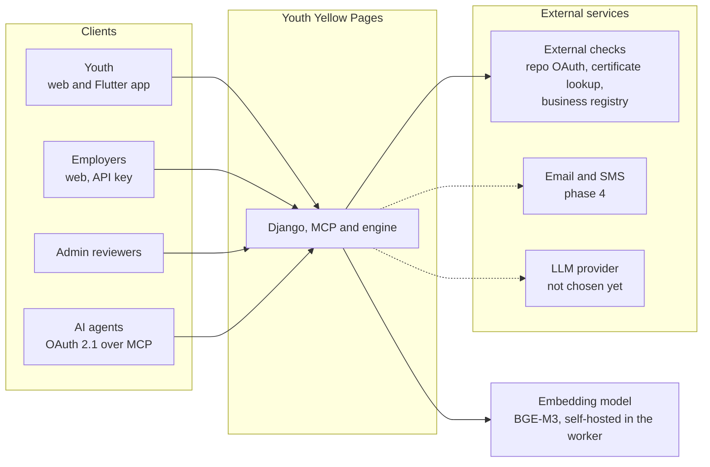

Actors:

| Actor | Role value [PDF §3] | Main interactions |
|---|---|---|
| Youth | `youth` | Create profile, upload evidence, set consent, accept contact requests, search opportunities |
| Employer | `employer` | Search talent, publish listings, record outcomes |
| Business | `business` | Publish service listings, search talent (same rules as employer) |
| Admin | `admin` | Review unknown skills, verify employers, handle reports, review ingested listings |
| Partner | `partner` | Institution account. Its listings arrive by CSV or feed, never by the REST listing endpoint. See TECHNICAL.md §14 |
| AI agent | (OAuth client) | Calls MCP tools within granted scopes |

---

## 3. Containers and deployment on Render

All compute runs on Render in one region chosen to be close to the majority of users. Four services share one codebase, and one managed database backs them.

| Render resource | Type | Runs | Scaling |
|---|---|---|---|
| `ypp-web` | Web Service | Gunicorn with Uvicorn workers, serving Django (REST under `/v1`, admin) and the MCP app at `/mcp` | Horizontal, 2 or more instances in production |
| `ypp-worker` | Background Worker | `celery -A config worker` for extraction, embedding, verification | Horizontal by queue depth |
| `ypp-beat` | Background Worker | `celery -A config beat`, one instance only | Exactly 1 |
| `ypp-db` | Render Postgres 16 | Primary data, `pgvector`, `pg_trgm`, full-text search | Vertical; read replica later |
| `ypp-kv` | Render Key Value (Redis-compatible) | Celery broker, result backend, rate-limit counters, short caches | Vertical |
| Attachments | Stored in `ypp-db` (phase 1). No separate file store | CVs, certificates, uploaded files, at most 5 MB each | Grows with the database. See D10 |

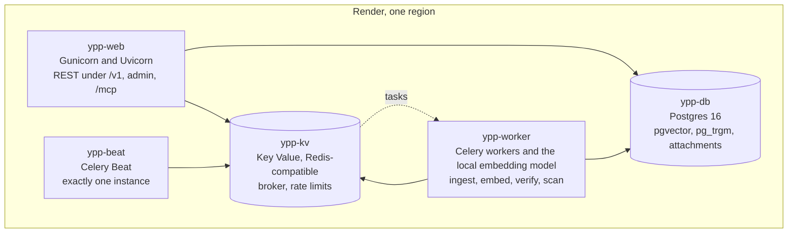

**Why web and MCP share a service in phase 1.** The MCP server calls the same services as REST, so a separate deployment would add a second process to operate with no security gain. The MCP app is mounted at `/mcp` inside the ASGI application. It can be split into its own Render service later without code changes to the services.

**Why beat is separate.** Celery Beat must run as a single instance or scheduled jobs (nightly reindex) would run more than once.

**Environment separation.** Three environments: `dev` (local Docker), `staging` (Render, separate database), and `prod` (Render, separate database). Staging uses production-like data volumes only with synthetic or consented data.

**Render-specific constraints to plan for:**

- Confirm `pgvector` is enabled on the chosen Render Postgres plan before the first migration. The migration `0001_extensions` fails fast if it is not available.
- Render web services can sleep on free plans. Production uses a paid plan so MCP and API clients do not see cold starts.
- Key Value is not durable storage. Nothing that must survive a restart (audit log, consent, outcomes) is stored in Redis.

---

## 4. Component design

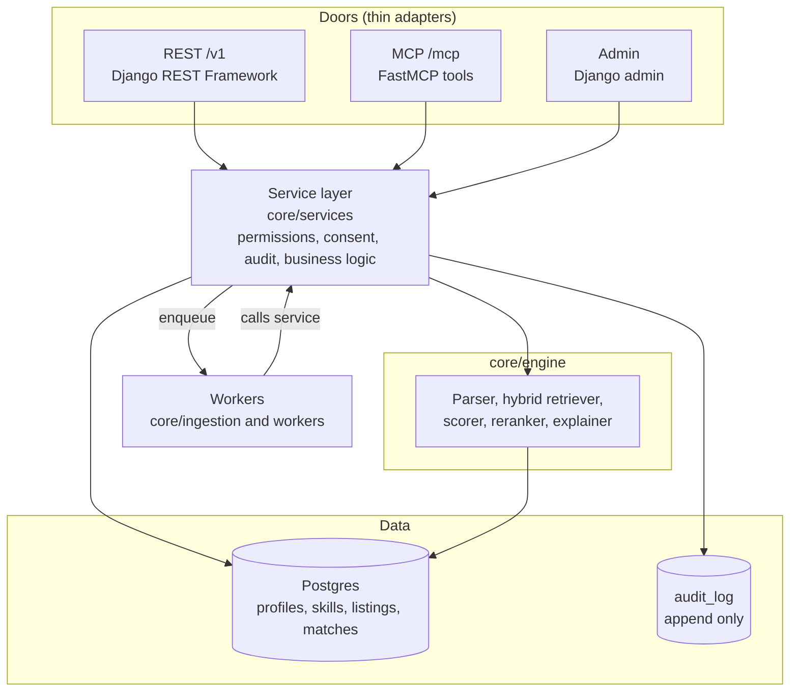

### 4.1 Service layer (`core/services`)

The service layer is a set of plain Python functions and classes. It does not know about HTTP or MCP. Each public function:

1. receives an `Actor` (user id, role, scopes, and the door it came through),
2. checks permissions and consent,
3. performs the operation,
4. writes an `audit_log` entry,
5. returns a typed result.

Main service groups:

| Service | Responsibility |
|---|---|
| `profiles` | Create and update profiles, field-level consent, deletion |
| `evidence` | Attach evidence, trigger verification |
| `skills` | Taxonomy lookup, alias resolution, review queue |
| `search` | Requirement parsing, hybrid retrieval, candidate generation |
| `scoring` | Skill scoring model, bands, confidence |
| `explain` | Grounded explanations and suggested next projects |
| `listings` | Create and search listings |
| `matches` | Record views, applications and outcomes |
| `contact` | Contact requests and acceptance |
| `reports` | Reports on profiles and listings |
| `verification` | Employer business-registration checks |
| `auth` | Access and refresh tokens, OAuth clients, API keys |
| `audit` | Write and read audit entries |

### 4.2 Engine (`core/engine`)

The engine runs the RAG pipeline described in section 6. It is a pipeline of stages with fixed inputs and outputs, so each stage can be tested and replaced on its own.

### 4.3 Doors

- **REST (`api/`)**: Django REST Framework views under `/v1`. Parses input, calls a service, serialises output.
- **MCP (`mcp_server/`)**: FastMCP tools, resources and prompts. Same pattern as REST, with tool schemas generated from type hints.
- **Admin**: Django admin for reviewers (skill review queue, employer verification, report handling).

### 4.4 Workers (`workers/`)

Celery tasks that must not block a request:

| Task | Trigger | Output |
|---|---|---|
| `extract_skills` | Profile created or updated | Skill candidates, proposed profile skills |
| `normalise_skills` | After extraction | Mapped skills or review-queue entries |
| `embed_profile` | Profile changed | New `profiles.embedding` |
| `embed_listing` | Listing created or changed | New `listings.embedding` |
| `verify_evidence` | Evidence attached | `evidence.verified` and `verified_by` |
| `reindex_stale` | Nightly (Beat) | Re-embeds records whose embedding is older than their last change |
| `purge_deleted` | Daily (Beat) | Hard-deletes data for accounts past the deletion window |
| `ingest_csv_batch` | Admin uploads a partner CSV | Creates and updates listings from a run, see TECHNICAL.md §14 |
| `pull_partner_feed` | Daily (Beat), phase 2 only | Pulls a partner feed under a written agreement |
| `expire_listings` | Daily (Beat) | Closes listings past `expires_at` and listings absent from two full syncs |
| `pull_greenhouse_board` | Daily (Beat), per enabled source | Connector for one employer's Greenhouse board, TECHNICAL.md §14.15 |
| `scrape_registered_page` | Daily (Beat), only for enabled scraper sources | Generic scraper, TECHNICAL.md §14.14 |
| `scan_attachment` | Triggered by upload completion | Checks file type and malware before the attachment is marked clean, TECHNICAL.md §15.2 |

---

## 5. Public surface (summary)

Full request and response contracts are not part of this document. This section lists what exists and which service each door calls.

### 5.1 REST under `/v1`

| Method and route | Purpose | Calls |
|---|---|---|
| `POST /v1/auth/token` | Obtain access token (OAuth 2.1 flow for agents; login for web and app) **(addition)** | `auth` |
| `POST /v1/auth/refresh` **(addition)** | Refresh access token | `auth` |
| `POST /v1/profiles` | Create or update a profile. Triggers extraction and embedding [PDF §8] | `profiles` |
| `GET /v1/profiles/{id}` **(addition)** | Read own profile, or public view if permitted | `profiles` |
| `PUT /v1/profiles/{id}/consent` **(addition)** | Set field-level consent | `profiles` |
| `DELETE /v1/profiles/{id}` **(addition)** | Request account and data deletion [PDF §9] | `profiles` |
| `POST /v1/profiles/{id}/evidence` | Attach evidence for verification [PDF §8] | `evidence` |
| `GET /v1/search/talent` | Employer search, same engine as MCP `search_talent` [PDF §8] | `search` |
| `GET /v1/search/opportunities` | Youth search for listings [PDF §8] | `search` |
| `GET /v1/skills` **(addition)** | Taxonomy lookup, same as MCP `list_skills` | `skills` |
| `POST /v1/listings` | Create a listing; employer verification required [PDF §8] | `listings` |
| `POST /v1/matches/{id}/outcome` | Record applied, interview, hired, retained [PDF §8] | `matches` |
| `POST /v1/contact-requests` **(addition)** | Employer requests contact with a candidate | `contact` |
| `POST /v1/contact-requests/{id}/accept` **(addition)** | Candidate accepts; contact details are released [PDF §7] | `contact` |
| `POST /v1/reports` **(addition)** | Report a profile or listing [PDF §9, §12] | `reports` |
| `POST /v1/employers/verification` **(addition)** | Submit business registration for checking [PDF §9] | `verification` |
| `POST /v1/attachments` **(addition)** | Upload a CV or certificate as multipart form data, at most 5 MB. The file is scanned before it can be used, TECHNICAL.md §15 | `attachments` |
| `GET /v1/attachments/{id}` **(addition)** | Download a clean attachment, for its owner or an employer whose contact request was accepted | `attachments` |
| `GET /v1/admin/skill-candidates` **(addition)** | Review queue for unknown skills [PDF §4] | `skills` (admin) |
| `POST /v1/admin/skill-candidates/{id}/decision` **(addition)** | Approve (adds to taxonomy) or reject | `skills` (admin) |

### 5.2 MCP at `/mcp`

Transport: streamable HTTP. Authentication: OAuth 2.1 bearer token with scopes.

**Status:** the six read tools are built and tested (`backend/mcp_server/`). `create_listing` and `record_outcome` need the Postgres store and are not built. Bearer tokens are resolved by a development token store until OAuth is built. See [TECHNICAL.md §7](TECHNICAL.md#7-mcp-tools).

| Tool | Access | Calls |
|---|---|---|
| `search_talent` | read | `search`, `scoring` |
| `get_profile` | read | `profiles` (consented fields only) |
| `score_candidate` | read | `scoring` |
| `search_opportunities` | read | `search` |
| `get_skill_gap` | read | `scoring`, `listings` |
| `list_skills` | read | `skills` |
| `create_listing` | write (employer only) | `listings` |
| `record_outcome` | write (scoped) | `matches` |

Resources (read-only): skills taxonomy, supported countries, scoring rubric.
Prompts: `shortlist_for_role`, `career_path_for_profile`.

### 5.3 Scopes

| Scope | Grants |
|---|---|
| `read:public` | Public profile fields, listings, taxonomy |
| `read:candidates` | Candidate search and scoring for employers and businesses |
| `write:listings` | Create listings (employer and business only) |
| `write:outcomes` | Record outcomes for matches the caller owns **(addition, scoped per match)** |

Phase 1 also issues API keys to verified employers. Keys map to the same scopes and are stored hashed.

---

## 6. Key flows

### 6.1 Profile ingestion

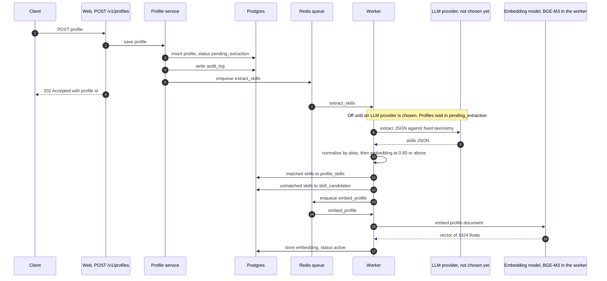

The client receives `202 Accepted` with the profile id. Search ignores profiles that are not `active`.

Profile status lifecycle:

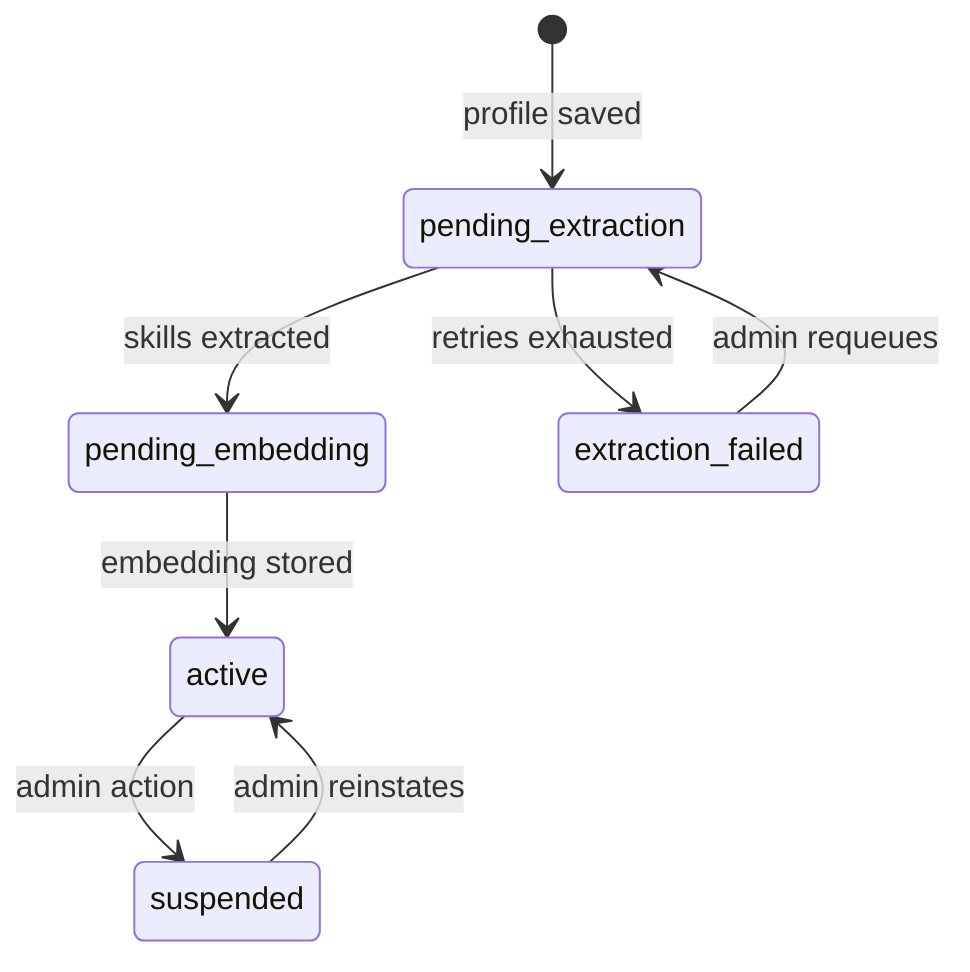

### 6.2 Evidence verification

Evidence is accepted in `pending` state. The worker runs the check that matches its type:

| Evidence type | Check |
|---|---|
| Project link (GitHub or portfolio) | Link reachable; repo ownership confirmed through OAuth |
| Certificate | Lookup against issuer where an API exists; otherwise marked unverified |
| Assessment | Result stored by the assessment provider; verified on receipt |
| Employer review | Employer confirmation through a signed link |

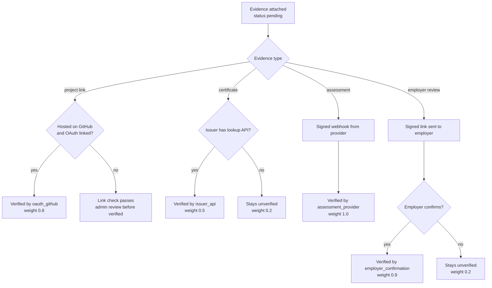

A verified item raises the evidence weight of its skill. Unverified items are visible to the candidate but do not count toward `S_evid` beyond the self-declared weight.

### 6.3 Search (RAG)

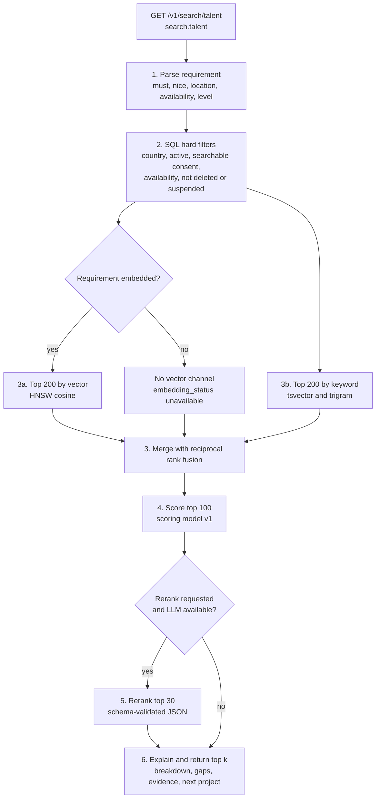

Steps 3a and 3b run in parallel where the embedding exists. Rerank is skipped when the client sets `rerank=false`.

Latency budget: under 2.5 seconds p95 for `k ≤ 10`. Steps 3a and 3b run in parallel. The LLM rerank is the most expensive step and can be skipped with a `rerank=false` parameter for low-bandwidth clients or when the LLM is degraded (see [TROUBLESHOOTING.md](TROUBLESHOOTING.md)).

### 6.4 Contact release

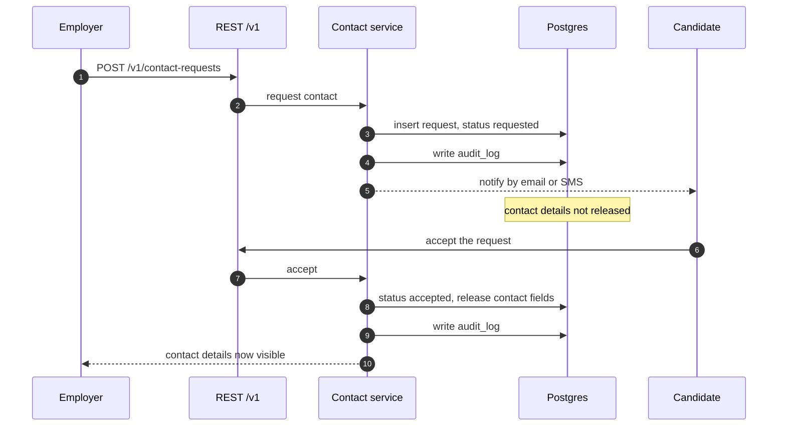

Contact request lifecycle:

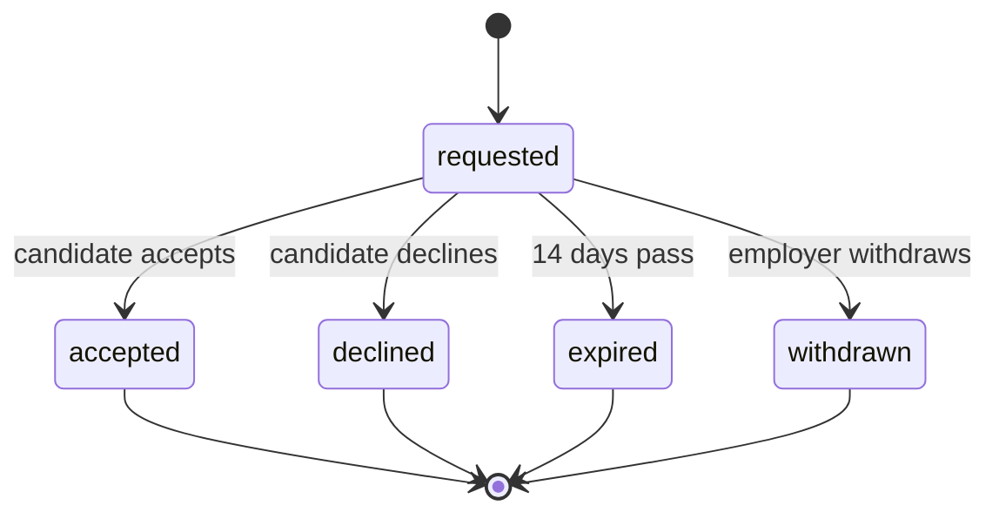

Contact details are never included in search results, MCP responses or logs before acceptance [PDF §7].

### 6.5 Outcome recording

An employer or the candidate records `applied`, `interview`, `hired` or `retained_6m` on a match. `retained_6m` is set by a scheduled job 6 months after `hired` with a confirmation request to both parties. Outcomes feed evaluation, not live ranking, in phase 1. Outcomes move forward only.

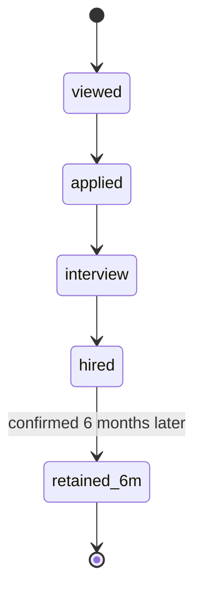

---

## 7. Security architecture

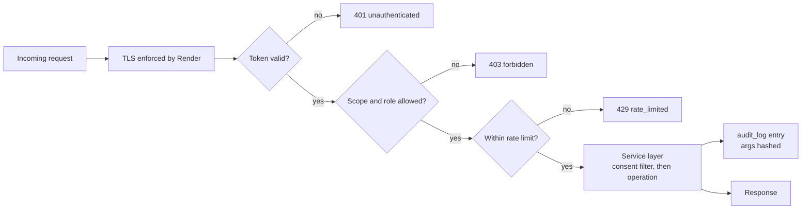

| Layer | Control |
|---|---|
| Transport | TLS on all endpoints, enforced by Render; HSTS on the web service |
| Authentication | Django-issued access tokens for web and app; OAuth 2.1 with PKCE for MCP clients; hashed API keys for employers |
| Authorisation | Role and scope checks in `core/services/permissions`, never in views |
| Consent | Field-level consent table; search and MCP responses filter by it in SQL |
| Data isolation | Service layer as primary enforcement; Postgres row-level security on `profiles`, `evidence` and `contact_requests` as second layer (see §8, decision D2) |
| Rate limits | Per token and per IP, counters in Redis; limits in [TECHNICAL.md](TECHNICAL.md) |
| Audit | Every service call writes `audit_log` with actor, door, operation and a hash of arguments |
| Secrets | Render environment variables; never committed |
| Prompt injection | Profile and CV text passed to the LLM as delimited data, never in the system prompt; tool calls from LLM output are not executed |
| Uploads | Type and size checks, malware scan before the file is linked to a profile **(addition)** |
| Deletion | Soft-delete on request, hard-delete by `purge_deleted` after 30 days, backups expire on the Render retention schedule **(addition: 30-day window to be confirmed with counsel)** |

Personal data regulation applies in all four countries: Kenya's Data Protection Act, Nigeria's Data Protection Act, South Africa's POPIA and Ghana's Data Protection Act [PDF §9]. Local counsel review is required before launch. No national ID numbers are collected.

---

## 8. Key decisions (ADRs)

| ID | Decision | Reason | Consequence |
|---|---|---|---|
| D1 | Render Postgres instead of Supabase | Hosting consolidated on Render, single provider for compute and database | Supabase auth and its RLS helpers are not used. Access control is in the service layer |
| D2 | Service layer is the primary enforcement point; Postgres RLS is a second layer | Keeps one permission model for REST and MCP. RLS adds defence in depth if the app is bypassed | Every permission rule is written once in services. RLS policies need session variables set per request |
| D3 | Web and MCP in one Render service in phase 1 | Fewer moving parts; both call the same services | MCP can be split later without service changes |
| D4 | Hybrid retrieval (vector and keyword with RRF) | Vector search misses exact skill names; keyword search misses synonyms | Two indexes to maintain on `profiles` |
| D5 | LLM rerank only on the top 30 | Cost and latency bounded | Rerank can be disabled per request and when the model is degraded |
| D6 | Unknown skills go to a review queue, never directly into the taxonomy | Protects taxonomy quality [PDF §4] | Admin review is needed for new skills |
| D7 | Scores are stored with their breakdown | Employers see why; audits and recalibration need the inputs | Storage cost is higher; `matches.breakdown` is JSON |
| D8 | Embedding dimension 1024, from the default model BAAI/bge-m3 (MIT licence, 100+ languages) | Matches the model's dense vector size. The model runs on our own worker, so profile text stays on our infrastructure. See TECHNICAL.md §16.1 | Changing the model means re-embedding everything; see TROUBLESHOOTING |
| D9 | Celery with Redis broker | Standard, supported on Render Key Value | Jobs must be idempotent |
| D10 | Attachments are stored in Postgres in phase 1 | Render has no object storage, and a Render persistent disk attaches to one service only, so the web app and the worker could not share files. Postgres is shared by both, and files are capped at 5 MB | The database grows with CV volume. Ops monitors its size, and a file store behind the same interface replaces the table when the threshold is reached (TECHNICAL.md §16.3) |
| D11 | Scoring weights are starting values, versioned | Weights are not yet calibrated [PDF §6] | Any change bumps `scoring_version` and must pass the regression suite |
| D12 | Opportunity data enters by admin CSV first, then official connectors (Greenhouse Job Board API), then feeds under a written agreement. Generic scraping only under the registry rules in TECHNICAL.md §14.14 | Partner pages are not ours to republish without permission. Greenhouse publishes board data for this purpose. See TECHNICAL.md §14 | Each source needs a permission reference before it runs. Scrapers fail closed on structure change |
| D13 | LinkedIn is not a listings source. Its Job Posting API pushes jobs into LinkedIn for approved partners and gives no job data to us. Candidate LinkedIn data arrives only as a file the candidate exports, or through official sign-in once verified | LinkedIn's User Agreement §8.2 prohibits scraping and third-party use of its data. The Job Posting API requires partner approval and is for posting, not sourcing. See TECHNICAL.md §14.13 | Matching LinkedIn-based candidates depends on exports or a later official sign-in integration |
| D15 | Listings are not limited to the four pilot countries. Each listing records eligible countries and a scope, and youth search defaults to listings open in the youth's country | Greenhouse covers employers worldwide, and the goal is a range of opportunities. See TECHNICAL.md §14.19 | Listing model stores eligibility. Search needs a scope filter. Scoring ignores scope |
| D14 | Attachments are scanned before use, and downloads are served by the API after an authorisation check. No public file links | CVs contain personal data and may carry malware. See TECHNICAL.md §15 | Uploads add a scan step and a status lifecycle before a file can be linked. Downloads pass through the API |
| D16 | No LLM provider is chosen yet. LLM features stay off, and the deterministic matcher and parser cover what they can | A provider needs a data-protection review for the four pilot countries and its retention terms. See TECHNICAL.md §16.2 | Profile extraction waits. Rerank is skipped. Scoring is unaffected |

---

## 9. Scalability and capacity

Targets for phase 1 (pilot scale, per [PDF §10]):

| Quantity | Target |
|---|---|
| Employers | 50 |
| Youth profiles | 200 active in the pilot, designed to scale to 100,000 |
| Skills in taxonomy | About 300 at launch |
| Search requests | Designed for 50 requests per second at peak, sized for 5 per second at pilot |

Scaling points, in order of expected pressure:

1. **Vector search** on `profiles` with HNSW. Memory grows with rows and dimension. Monitor index size against the Render plan.
2. **LLM rerank** calls. Bounded by top 30 per search, cached per (requirement hash, profile version).
3. **Embedding workers** during bulk import. Scale the worker service horizontally.
4. **Postgres connections.** Use a connection pooler or Django's `CONN_MAX_AGE` setting; keep the web and worker pools small.

---

## 10. Failure modes

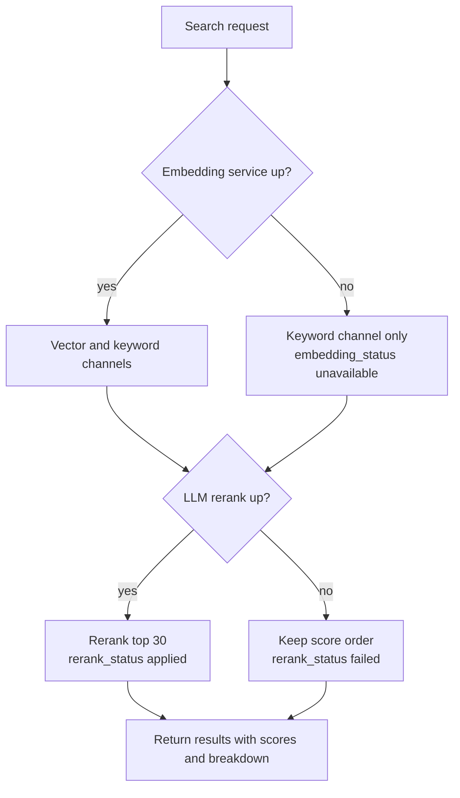

| Failure | Behaviour |
|---|---|
| Embedding model cannot load or runs out of memory | Search runs keyword-only and reports `embedding_status = unavailable`. Profiles that need an embedding stay `pending_embedding` and are retried after the worker is restarted or resized |
| LLM provider unavailable, or none configured | Extraction waits in `pending_extraction`. Rerank is skipped and reports `rerank_status = skipped` or `failed`. Scores still returned |
| Redis unavailable | Rate limits fail closed on write endpoints, open on read endpoints with logging. Celery tasks wait and retry |
| Postgres unavailable | Requests return `503`. No partial writes because each service call runs in a transaction |
| Worker crash mid-task | Celery acknowledges late; tasks are idempotent, so a re-run produces the same state |
| Database write fails during an upload | Upload returns `503`; nothing is stored, and no attachment is linked to a profile |

---

## 11. Observability

- **Logs:** structured JSON, one line per request, with request id, actor id (not personal data), door, route or tool, status and duration. Personal data is never logged.
- **Metrics:** request rate and latency per route and tool; search stage timings; embedding and LLM call counts, errors and latency; Celery queue depth and task age; match score distribution (for the monthly fairness report).
- **Alerts:** 5xx rate above 2% for 5 minutes; search p95 above 2.5 seconds; queue age above 10 minutes; nightly reindex not completed by 06:00 local time.
- **Tracing:** request id propagated into Celery task headers so an upload can be followed from the request to its embedding.

---

## 12. Evaluation and fairness hooks

- The scoring module records `scoring_version` on every `matches` row.
- The regression suite runs the labelled gold set (about 200 pairs rated 0 to 3 [PDF §10]) and fails the build if nDCG at 10 drops below the stored baseline.
- Monthly fairness report uses `matches`, `profiles` and `outcomes`. It joins gender, country and region from consented demographic fields **only for reporting**, never for scoring [PDF §6].

---

## 13. Open items

| Item | Owner | Needed by |
|---|---|---|
| Confirm the 30-day deletion window and backup retention with local counsel | Legal | Before pilot |
| Confirm attachment storage in Postgres, and the size threshold for moving it to a file store (D10) | Engineering | Before evidence upload work |
| Choose the LLM provider, after a data-protection review for the four pilot countries (D16) | Product and Legal | Before profile extraction and rerank are enabled |
| Measure the embedding model's peak memory on staging, then choose the worker plan | Engineering | Before staging |
| Confirm the Render region and Postgres plan size | Engineering | Before staging |
| Confirm the pgvector extension on the selected Render plan | Engineering | Before first migration |
| Agree the employer business-registration check provider per country | Operations | Before employer onboarding |
| Choose certificate issuers with lookup APIs | Product | Phase 2 |
