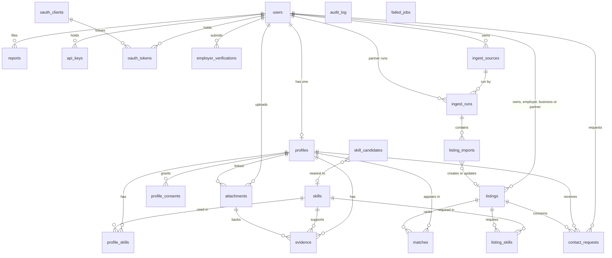

# Database Design

This document defines the PostgreSQL schema for Youth Yellow Pages: tables, columns, types, constraints, indexes, retention and migration rules.

The database is **PostgreSQL 16 on Render** with the `pgvector` and `pg_trgm` extensions [PDF §2, §3]. Row-level security is a second layer over the service-layer checks (see [ARCHITECTURE.md](ARCHITECTURE.md) decision D2).

Source references use `[PDF §n]`. **(addition)** marks tables or columns the PDF does not define but the design needs.

---

## 1. Conventions

| Rule | Detail |
|---|---|
| Primary keys | `uuid`, generated by the application (UUIDv7 for time ordering). Column name `id` |
| Timestamps | `timestamptz`, UTC. `created_at` and `updated_at` on every mutable table |
| Soft delete | `deleted_at timestamptz null` on `users`, `profiles`, `evidence`, `listings` |
| Enumerations | `text` with a `CHECK` constraint, not Postgres `ENUM`, so values can change without locking migrations |
| Money | `numeric(14,2)` with a `currency` column (ISO 4217) |
| Country | ISO 3166-1 alpha-2 `char(2)`: `NG`, `ZA`, `KE`, `GH` only, enforced by `CHECK` |
| Text search | Generated `tsvector` columns, `GIN` indexed |
| Vectors | `vector(1024)` from `pgvector`, matching `EMBEDDING_DIM` |
| Names | `snake_case`, plural table names, `*_id` foreign keys |
| Naming for indexes | `ix_<table>_<cols>`, `uq_<table>_<cols>`, `fk_<table>_<col>` |

---

## 2. Extensions

```sql
CREATE EXTENSION IF NOT EXISTS vector;     -- pgvector
CREATE EXTENSION IF NOT EXISTS pg_trgm;    -- trigram similarity
CREATE EXTENSION IF NOT EXISTS pgcrypto;   -- gen_random_bytes for tokens
CREATE EXTENSION IF NOT EXISTS citext;     -- case-insensitive email
```

Migration `0001_extensions` runs these and fails fast with a clear message if `vector` is not available on the Render plan **(addition)**. See [TROUBLESHOOTING.md](TROUBLESHOOTING.md#pgvector-not-available).

---

## 3. Entity overview



`audit_log` and `failed_jobs` have no foreign keys by design. They must keep their rows after the records they describe are purged.

---

## 4. Tables

### 4.1 `users`

Source: [PDF §3]. Columns marked **(addition)** are needed for auth and compliance.

| Column | Type | Null | Default | Notes |
|---|---|---|---|---|
| `id` | `uuid` | no | | PK |
| `email` | `citext` | yes | | Unique among non-deleted rows. Nullable for phone-only accounts **(addition)** |
| `phone` | `text` | yes | | E.164 format, unique among non-deleted rows **(addition)** |
| `password_hash` | `text` | yes | | Argon2id. Null for OAuth-only accounts **(addition)** |
| `role` | `text` | no | | `CHECK (role IN ('youth','employer','business','admin','partner'))` **(`partner` added for institutional listing sources, see TECHNICAL.md §14)** |
| `country` | `char(2)` | no | | `CHECK (country IN ('NG','ZA','KE','GH'))` |
| `full_name` | `text` | yes | | Stored for account display. Never used in scoring **(addition)** |
| `consent_terms_version` | `text` | yes | | Version of terms accepted [PDF §3] |
| `consent_terms_at` | `timestamptz` | yes | | When terms were accepted |
| `consent_privacy_version` | `text` | yes | | **(addition)** |
| `consent_privacy_at` | `timestamptz` | yes | | **(addition)** |
| `suspended_at` | `timestamptz` | yes | | Set by admin **(addition)** |
| `last_login_at` | `timestamptz` | yes | | **(addition)** |
| `created_at` | `timestamptz` | no | `now()` | |
| `updated_at` | `timestamptz` | no | `now()` | |
| `deleted_at` | `timestamptz` | yes | | Soft delete **(addition)** |

Constraints:

- `CHECK (email IS NOT NULL OR phone IS NOT NULL)`
- `UNIQUE (email) WHERE deleted_at IS NULL`
- `UNIQUE (phone) WHERE deleted_at IS NULL`

Indexes:

- `ix_users_role_country` on `(role, country)` WHERE `deleted_at IS NULL`

Notes:

- Consent flags in [PDF §3] are represented by the terms and privacy version columns, plus field-level consent in `profile_consents` (section 4.8). Account-level consent is not a single boolean, so that the version accepted is auditable.

### 4.2 `profiles`

Source: [PDF §3]. One profile per user for youth and business accounts **(addition: one profile per user is enforced)**.

| Column | Type | Null | Default | Notes |
|---|---|---|---|---|
| `id` | `uuid` | no | | PK |
| `user_id` | `uuid` | no | | FK `users.id`, unique |
| `headline` | `text` | yes | | Max 140 characters |
| `bio` | `text` | yes | | Max 2000 characters |
| `location_city` | `text` | yes | | **(addition, split from `location`)** |
| `location_region` | `text` | yes | | **(addition)** |
| `availability` | `text` | yes | | `CHECK (availability IN ('now','within_30_days','flexible'))` |
| `languages` | `text[]` | no | `'{}'` | ISO 639-1 codes [PDF §3] |
| `pay_min` | `numeric(14,2)` | yes | | Expectation, optional **(addition)** |
| `pay_max` | `numeric(14,2)` | yes | | **(addition)** |
| `pay_currency` | `char(3)` | yes | | **(addition)** |
| `status` | `text` | no | `'pending_extraction'` | `CHECK (status IN ('pending_extraction','pending_embedding','active','extraction_failed','suspended'))` **(addition)** |
| `searchable` | `boolean` | no | `false` | Candidate-level switch for search. Set true only when `search` consent is granted **(addition)** |
| `embedding` | `vector(1024)` | yes | | [PDF §3] |
| `embedding_model` | `text` | yes | | Model id used, for reindex decisions **(addition)** |
| `embedding_stale_at` | `timestamptz` | yes | | Set when a change needs re-embedding **(addition)** |
| `document_text` | `text` | yes | | Profile document used for embedding; kept for explanation and debugging **(addition)** |
| `search_tsv` | `tsvector` | no | generated | Generated from `headline`, `bio`, `document_text` **(addition)** |
| `created_at` | `timestamptz` | no | `now()` | |
| `updated_at` | `timestamptz` | no | `now()` | |
| `deleted_at` | `timestamptz` | yes | | |

Generated column:

```sql
search_tsv tsvector GENERATED ALWAYS AS (
  setweight(to_tsvector('english', coalesce(headline, '')), 'A') ||
  setweight(to_tsvector('english', coalesce(bio, '')), 'B') ||
  setweight(to_tsvector('english', coalesce(document_text, '')), 'C')
) STORED
```

Constraints:

- `UNIQUE (user_id)`
- `CHECK (char_length(headline) <= 140)`
- `CHECK (char_length(bio) <= 2000)`
- `CHECK (pay_min IS NULL OR pay_max IS NULL OR pay_min <= pay_max)`
- `CHECK (cardinality(languages) <= 10)`

Indexes:

| Index | Definition | Purpose |
|---|---|---|
| `ix_profiles_embedding_hnsw` | `USING hnsw (embedding vector_cosine_ops) WITH (m = 16, ef_construction = 64)` | Vector candidate generation [PDF §5] |
| `ix_profiles_search_tsv` | `USING gin (search_tsv)` | Keyword candidate generation |
| `ix_profiles_filter` | `(status, searchable, availability)` WHERE `deleted_at IS NULL` | Hard filters |
| `ix_profiles_stale` | `(embedding_stale_at)` WHERE `embedding_stale_at IS NOT NULL` | Nightly reindex |

HNSW parameters `m = 16` and `ef_construction = 64` are starting values **(default)**. Set `hnsw.ef_search` per session, default 40 **(default)**. Measure index build time and memory on the Render plan before the pilot.

### 4.3 `skills`

Source: [PDF §3]. Canonical taxonomy, about 300 skills at launch.

| Column | Type | Null | Default | Notes |
|---|---|---|---|---|
| `id` | `uuid` | no | | PK |
| `slug` | `text` | no | | Stable identifier, e.g. `python`, `data-entry` **(addition)** |
| `name` | `text` | no | | Display name |
| `aliases` | `text[]` | no | `'{}'` | Alternative names, normalised lowercase [PDF §3] |
| `taxonomy_path` | `text[]` | no | | e.g. `{'Technology','Software','Languages'}` [PDF §3] |
| `category` | `text` | no | | First element of `taxonomy_path` **(addition, for filtering)** |
| `description` | `text` | yes | | Used when embedding the skill **(addition)** |
| `suggested_projects` | `jsonb` | no | `'[]'` | Fixed list of next-project suggestions [ARCHITECTURE.md §6.3] **(addition)** |
| `embedding` | `vector(1024)` | yes | | [PDF §3] |
| `active` | `boolean` | no | `true` | Retired skills stay for history **(addition)** |
| `created_at` | `timestamptz` | no | `now()` | |
| `updated_at` | `timestamptz` | no | `now()` | |

Constraints:

- `UNIQUE (slug)`
- `UNIQUE (lower(name))`
- `CHECK (cardinality(taxonomy_path) >= 1)`

Indexes:

| Index | Definition | Purpose |
|---|---|---|
| `ix_skills_embedding_hnsw` | `USING hnsw (embedding vector_cosine_ops)` | Normalisation by similarity [PDF §4] |
| `ix_skills_aliases` | `USING gin (aliases)` | Alias lookup |
| `ix_skills_name_trgm` | `USING gin (name gin_trgm_ops)` | Trigram matching on names |

### 4.4 `profile_skills`

Source: [PDF §3].

| Column | Type | Null | Default | Notes |
|---|---|---|---|---|
| `profile_id` | `uuid` | no | | FK `profiles.id` ON DELETE CASCADE |
| `skill_id` | `uuid` | no | | FK `skills.id` |
| `level` | `smallint` | no | | `CHECK (level BETWEEN 1 AND 5)` [PDF §3] |
| `years` | `numeric(4,1)` | yes | | `CHECK (years IS NULL OR years >= 0)` [PDF §3] |
| `last_used` | `date` | yes | | Month precision is enough; stored as first day of month **(addition: precision rule)** |
| `source` | `text` | no | | `CHECK (source IN ('self','assessment','evidence','endorsed'))` [PDF §3] |
| `created_at` | `timestamptz` | no | `now()` | |
| `updated_at` | `timestamptz` | no | `now()` | |

Constraints:

- `PRIMARY KEY (profile_id, skill_id)`
- `CHECK (last_used IS NULL OR last_used <= current_date + interval '1 month')` **(addition)**

Indexes:

- `ix_profile_skills_skill` on `(skill_id, level)` for keyword and gap queries.

Notes:

- `source` describes how the level was established, not how strongly the skill is evidenced. Evidence strength is held in `evidence` and used for `S_evid` [TECHNICAL.md §6.2].
- A profile skill comes from `self` when the candidate declares it, `assessment` when a test sets the level, `evidence` when a verified item sets it, and `endorsed` when an employer or peer endorses it.

### 4.5 `evidence`

Source: [PDF §3]. Evidence is attached to a profile and optionally to a skill.

| Column | Type | Null | Default | Notes |
|---|---|---|---|---|
| `id` | `uuid` | no | | PK |
| `profile_id` | `uuid` | no | | FK `profiles.id` ON DELETE CASCADE |
| `skill_id` | `uuid` | yes | | FK `skills.id`. Links evidence to a skill **(addition)** |
| `type` | `text` | no | | `CHECK (type IN ('project','certificate','assessment','employer_review'))` [PDF §3] |
| `title` | `text` | no | | Short label **(addition)** |
| `url` | `text` | yes | | Required for `project` and `certificate` links; `CHECK` for http(s) scheme **(addition)** |
| `attachment_id` | `uuid` | yes | | FK `attachments.id` for an uploaded file. Only `clean` attachments may be linked **(addition)** |
| `summary` | `text` | yes | | Summary used in profile document, max 500 characters **(addition)** |
| `verified` | `boolean` | no | `false` | [PDF §3] |
| `verification_status` | `text` | no | `'pending'` | `CHECK (verification_status IN ('pending','reachable','verified','rejected','expired'))` **(addition)** |
| `verified_by` | `text` | yes | | `oauth_github`, `admin`, `issuer_api`, `assessment_provider`, `employer_confirmation` [PDF §3] |
| `verified_at` | `timestamptz` | yes | | **(addition)** |
| `date` | `date` | yes | | Date of the achievement or issue [PDF §3] |
| `source_weight` | `numeric(3,2)` | yes | | Computed from type and verification at write time; see TECHNICAL §6.2 **(addition, cached)** |
| `created_at` | `timestamptz` | no | `now()` | |
| `updated_at` | `timestamptz` | no | `now()` | |
| `deleted_at` | `timestamptz` | yes | | |

Constraints:

- `CHECK (verified = false OR verification_status = 'verified')`
- `CHECK (type <> 'project' OR url IS NOT NULL OR attachment_id IS NOT NULL)`
- `CHECK (url IS NULL OR url ~* '^https?://')`

Indexes:

- `ix_evidence_profile` on `(profile_id)` WHERE `deleted_at IS NULL`
- `ix_evidence_skill` on `(profile_id, skill_id)` WHERE `deleted_at IS NULL`
- `ix_evidence_pending` on `(verification_status)` WHERE `verification_status = 'pending'`

Notes:

- `source_weight` is written from the rules in TECHNICAL §6.2: verified assessment 1.0, verified employer review 0.9, verified project 0.8, verified certificate 0.5, otherwise 0.2. Stored so search does not recompute weights per row. Recomputed when verification changes.

### 4.6 `listings`

Source: [PDF §3]. Required skills are in `listing_skills` **(addition)** because a list of required skills with levels and a must-have flag cannot be stored cleanly in one column.

| Column | Type | Null | Default | Notes |
|---|---|---|---|---|
| `id` | `uuid` | no | | PK |
| `owner_user_id` | `uuid` | no | | FK `users.id` (employer or business) **(addition)** |
| `type` | `text` | no | | `CHECK (type IN ('business','service','job','internship','apprenticeship'))` [PDF §3] |
| `title` | `text` | no | | Max 140 characters |
| `description` | `text` | no | | Max 5000 characters [PDF §3] |
| `country` | `char(2)` | yes | | Primary country, the first entry of `eligible_countries`. `CHECK (country IS NULL OR country ~ '^[A-Z]{2}$')`. **(addition: no longer limited to the four pilot countries, see TECHNICAL.md §14.19)** |
| `location_text` | `text` | yes | | Location as the source gave it. Kept for review and audit **(addition)** |
| `eligible_countries` | `char(2)[]` | no | `'{}'` | Countries where applicants are eligible, from the location text **(addition)** |
| `unmapped_locations` | `text[]` | no | `'{}'` | Location parts that could not be matched to a country. Non-empty means review **(addition)** |
| `work_mode` | `text` | no | `'unspecified'` | `CHECK (work_mode IN ('onsite','hybrid','remote','onsite_or_hybrid','unspecified'))` **(addition)** |
| `scope` | `text` | no | `'unspecified'` | `CHECK (scope IN ('in_region','remote_in_region','outside_region','remote_outside_region','unspecified'))`. TECHNICAL.md §14.19 **(addition)** |
| `location_city` | `text` | yes | | **(addition)** |
| `location_region` | `text` | yes | | **(addition)** |
| `pay_min` | `numeric(14,2)` | yes | | **(addition)** |
| `pay_max` | `numeric(14,2)` | yes | | **(addition)** |
| `pay_currency` | `char(3)` | yes | | **(addition)** |
| `availability_start` | `date` | yes | | **(addition)** |
| `status` | `text` | no | `'draft'` | `CHECK (status IN ('draft','pending_review','active','paused','closed','rejected'))` [PDF §3] |
| `review_notes` | `text` | yes | | Admin notes, not shown to others **(addition)** |
| `origin` | `text` | no | `'employer'` | `CHECK (origin IN ('employer','admin_import','feed'))` **(addition, TECHNICAL.md §14)** |
| `source_key` | `text` | yes | | Partner source, for example `kcau-placement-csv`. Null for employer-posted listings **(addition)** |
| `external_id` | `text` | yes | | Identifier in the source system, used for dedupe and updates **(addition)** |
| `source_url` | `text` | yes | | Link to the original posting. `CHECK` http or https **(addition)** |
| `department` | `text` | yes | | For example a school or faculty name, shown in search filters **(addition)** |
| `expires_at` | `timestamptz` | yes | | Listing closes automatically after this time. Default for feeds with no closing date: first seen plus 30 days **(addition, default)** |
| `first_seen_at` | `timestamptz` | yes | | When an ingested listing first appeared in a source **(addition)** |
| `last_seen_at` | `timestamptz` | yes | | Last sync in which the listing appeared in the source **(addition)** |
| `missing_runs` | `smallint` | no | `0` | Consecutive full syncs in which the listing was absent. Closes at 2 **(addition, default)** |
| `embedding` | `vector(1024)` | yes | | [PDF §3] |
| `embedding_stale_at` | `timestamptz` | yes | | **(addition)** |
| `search_tsv` | `tsvector` | no | generated | Generated from `title` and `description` **(addition)** |
| `created_at` | `timestamptz` | no | `now()` | |
| `updated_at` | `timestamptz` | no | `now()` | |
| `deleted_at` | `timestamptz` | yes | | |

Constraints:

- `CHECK (pay_min IS NULL OR pay_max IS NULL OR pay_min <= pay_max)`
- Only users with role `employer`, `business` or `partner` may own a listing. A `CHECK` cannot reference another table, so this rule is enforced in the `listings` service and covered by a test **(note)**
- Partner-owned listings have `origin` set to `admin_import` or `feed`. Employers post with `origin = 'employer'`. Only ingestion may set the other values.
- `UNIQUE (source_key, external_id) WHERE source_key IS NOT NULL AND deleted_at IS NULL` prevents the same source record from appearing twice **(addition)**.

Indexes:

| Index | Definition |
|---|---|
| `ix_listings_embedding_hnsw` | `USING hnsw (embedding vector_cosine_ops)` |
| `ix_listings_search_tsv` | `USING gin (search_tsv)` |
| `ix_listings_active` | `(country, status)` WHERE `deleted_at IS NULL` |

### 4.7 `listing_skills`

Source: [PDF §3] lists "required skills with level and must-have flag" under `listings`. This join table implements that **(addition)**.

| Column | Type | Null | Default | Notes |
|---|---|---|---|---|
| `listing_id` | `uuid` | no | | FK `listings.id` ON DELETE CASCADE |
| `skill_id` | `uuid` | no | | FK `skills.id` |
| `level` | `smallint` | no | | `CHECK (level BETWEEN 1 AND 5)` |
| `must_have` | `boolean` | no | `false` | Must-have is weight 1.0, nice-to-have 0.4 [PDF §6] |

Constraints:

- `PRIMARY KEY (listing_id, skill_id)`

Indexes:

- `ix_listing_skills_skill` on `(skill_id)`

### 4.8 `profile_consents`

Source: [PDF §9] "Field-level consent. Candidates choose what is visible." **(addition: table is the design for this rule)**

| Column | Type | Null | Default | Notes |
|---|---|---|---|---|
| `id` | `uuid` | no | | PK |
| `profile_id` | `uuid` | no | | FK `profiles.id` ON DELETE CASCADE |
| `field` | `text` | no | | `CHECK (field IN ('search','headline','bio','location','availability','languages','pay','skills','evidence','contact','document'))` **(`skills` added with the MCP build)** |
| `audience` | `text` | no | | `CHECK (audience IN ('public','employers','opportunity_matching','none'))` |
| `granted` | `boolean` | no | | Current state |
| `granted_at` | `timestamptz` | yes | | |
| `revoked_at` | `timestamptz` | yes | | |
| `version` | `integer` | no | `1` | Increments on each change |

Constraints:

- `UNIQUE (profile_id, field, audience)`

Notes:

- `field = 'search'` with `audience = 'employers'` is the switch behind `profiles.searchable` **(addition)**. Setting it to false removes the profile from search immediately, in the same transaction.
- **Skill visibility rule (as built):** a searchable profile's skills, levels and score breakdown are shown to employers, because skill matching is the purpose of search. The `skills` field is therefore consent for the **public** audience only. It controls whether `get_profile` returns skills.
- Employer search results show `headline` and verified evidence links only when those fields are granted to the `employers` audience (`core/engine/explain.py`). The reranker prompt also includes `bio` under the same rule (`core/engine/rerank.py`). Location, languages and availability are used for fit scoring but are not echoed in employer results yet.
- `field = 'contact'` is never released by a read. It is released only by an accepted contact request (section 4.9) [PDF §7].
- Each change writes an `audit_log` entry.

### 4.9 `contact_requests`

Source: [PDF §7] "Contact details are released only after the candidate accepts." **(addition: table is the design for this rule)**

| Column | Type | Null | Default | Notes |
|---|---|---|---|---|
| `id` | `uuid` | no | | PK |
| `profile_id` | `uuid` | no | | FK `profiles.id` |
| `requester_user_id` | `uuid` | no | | FK `users.id` (employer or business) |
| `listing_id` | `uuid` | yes | | FK `listings.id`, if the request is about a listing |
| `message` | `text` | yes | | Max 1000 characters |
| `status` | `text` | no | `'requested'` | `CHECK (status IN ('requested','accepted','declined','expired','withdrawn'))` |
| `responded_at` | `timestamptz` | yes | | |
| `expires_at` | `timestamptz` | no | | Requested + 14 days **(default)** |
| `created_at` | `timestamptz` | no | `now()` | |

Constraints:

- `UNIQUE NULLS NOT DISTINCT (profile_id, requester_user_id, listing_id)` where `status = 'requested'`

Indexes:

- `ix_contact_requests_profile` on `(profile_id, status)`

### 4.10 `matches`

Source: [PDF §3]. A match is created when a search returns a candidate for a listing or a requirement, and it tracks outcomes.

| Column | Type | Null | Default | Notes |
|---|---|---|---|---|
| `id` | `uuid` | no | | PK |
| `profile_id` | `uuid` | no | | FK `profiles.id` |
| `listing_id` | `uuid` | yes | | FK `listings.id`. Null for requirement searches without a listing **(addition)** |
| `requester_user_id` | `uuid` | yes | | Employer who ran the search, null for opportunity search by youth **(addition)** |
| `score` | `numeric(5,2)` | no | | Final score [PDF §3, TECHNICAL §6] |
| `band` | `text` | no | | `CHECK (band IN ('strong','good','partial','weak'))` |
| `confidence` | `numeric(3,2)` | no | | 0 to 1 [TECHNICAL §6.6] |
| `breakdown` | `jsonb` | no | | Each component value and weight, gate flag, `sem_scale` [PDF §3] |
| `scoring_version` | `text` | no | | e.g. `v1` **(addition)** |
| `requirement_hash` | `text` | yes | | Cache key for explanations **(addition)** |
| `retrieval_channels` | `text[]` | no | `'{}'` | e.g. `{vector,keyword}`, `{keyword_only}` **(addition)** |
| `rerank_status` | `text` | no | `'skipped'` | `CHECK (rerank_status IN ('applied','skipped','failed'))` **(addition)** |
| `outcome` | `text` | yes | | `CHECK (outcome IN ('viewed','applied','interview','hired','retained_6m'))` [PDF §3] |
| `outcome_at` | `timestamptz` | yes | | **(addition)** |
| `created_at` | `timestamptz` | no | `now()` | |
| `updated_at` | `timestamptz` | no | `now()` | |

Constraints:

- `CHECK (score >= 0 AND score <= 100)`
- `UNIQUE NULLS NOT DISTINCT (profile_id, listing_id, requester_user_id, scoring_version)` **(addition)**; prevents duplicate rows for the same run. `NULLS NOT DISTINCT` (PostgreSQL 15 and later) makes null `listing_id` or `requester_user_id` values compare as equal. Re-running search updates the row.

Indexes:

- `ix_matches_listing_score` on `(listing_id, score DESC)`
- `ix_matches_profile` on `(profile_id)`
- `ix_matches_outcome` on `(outcome, outcome_at)`

Notes:

- `outcome` is a progression: `viewed` → `applied` → `interview` → `hired` → `retained_6m`. The service rejects backwards moves **(addition)**.
- `retained_6m` is set by the scheduled job 6 months after `hired` [PDF §6 product metrics, TECHNICAL §10.3].

### 4.11 `skill_candidates`

Source: [PDF §4] "Unknown skills go to a review queue, never straight into the taxonomy." **(addition: table is the design for this rule)**

| Column | Type | Null | Default | Notes |
|---|---|---|---|---|
| `id` | `uuid` | no | | PK |
| `raw_text` | `text` | no | | As extracted, max 80 characters |
| `normalised_text` | `text` | no | | Lowercased, trimmed |
| `profile_id` | `uuid` | yes | | First profile where it was seen |
| `occurrences` | `integer` | no | `1` | Count across profiles |
| `nearest_skill_id` | `uuid` | yes | | Best embedding match, for reviewer context |
| `nearest_similarity` | `numeric(4,3)` | yes | | |
| `embedding` | `vector(1024)` | yes | | |
| `status` | `text` | no | `'pending'` | `CHECK (status IN ('pending','approved','merged','rejected'))` |
| `decided_by` | `uuid` | yes | | FK `users.id` (admin) |
| `decided_at` | `timestamptz` | yes | | |
| `resulting_skill_id` | `uuid` | yes | | Set when approved or merged |
| `created_at` | `timestamptz` | no | `now()` | |

Constraints:

- `UNIQUE (normalised_text) WHERE status = 'pending'`

Indexes:

- `ix_skill_candidates_pending` on `(status, occurrences DESC)`

### 4.12 `reports`

Source: [PDF §9, §12] "Report button on every listing and profile." **(addition: table is the design for this rule)**

| Column | Type | Null | Default | Notes |
|---|---|---|---|---|
| `id` | `uuid` | no | | PK |
| `reporter_user_id` | `uuid` | yes | | Null if anonymous reporting is allowed |
| `target_type` | `text` | no | | `CHECK (target_type IN ('profile','listing'))` |
| `target_id` | `uuid` | no | | Profile or listing id |
| `reason` | `text` | no | | `CHECK (reason IN ('fake','scam','inappropriate','discrimination','privacy','other'))` |
| `details` | `text` | yes | | Max 1000 characters |
| `status` | `text` | no | `'open'` | `CHECK (status IN ('open','reviewing','actioned','dismissed'))` |
| `handled_by` | `uuid` | yes | | FK `users.id` (admin) |
| `handled_at` | `timestamptz` | yes | | |
| `created_at` | `timestamptz` | no | `now()` | |

Constraints:

- `UNIQUE (reporter_user_id, target_type, target_id)` WHERE `reporter_user_id IS NOT NULL` (one report per reporter per target)

Indexes:

- `ix_reports_open` on `(status, created_at)` WHERE `status IN ('open','reviewing')`

Notes:

- Reports are not shown to the reported party or to other users.
- A profile or listing with two or more open reports is moved to `pending_review` automatically **(default)**.

### 4.13 `employer_verifications`

Source: [PDF §9] "Employer verification (business registration check)." **(addition)**

| Column | Type | Null | Default | Notes |
|---|---|---|---|---|
| `id` | `uuid` | no | | PK |
| `user_id` | `uuid` | no | | FK `users.id` |
| `registration_country` | `char(2)` | no | | `CHECK (registration_country IN ('NG','ZA','KE','GH'))` |
| `registration_number` | `text` | no | | Business registration number. Not a personal identifier |
| `legal_name` | `text` | no | | |
| `status` | `text` | no | `'submitted'` | `CHECK (status IN ('submitted','checking','verified','rejected'))` |
| `checked_by` | `text` | yes | | Provider or `admin` |
| `checked_at` | `timestamptz` | yes | | |
| `created_at` | `timestamptz` | no | `now()` | |

Constraints:

- `UNIQUE (registration_country, registration_number)` where `status = 'verified'` (one verified account per business registration)

Notes:

- Only business registration data is stored. National ID numbers are never collected [PDF §9].

### 4.14 `api_keys`

Source: [PDF §7] "API keys for employers in phase 1." **(addition)**

| Column | Type | Null | Default | Notes |
|---|---|---|---|---|
| `id` | `uuid` | no | | PK |
| `user_id` | `uuid` | no | | FK `users.id` |
| `name` | `text` | no | | Label chosen by the employer |
| `prefix` | `text` | no | | First 8 characters, visible in UI |
| `key_hash` | `text` | no | | SHA-256 of the full key. Unique |
| `scopes` | `text[]` | no | | Subset of allowed scopes [ARCHITECTURE.md §5.3] |
| `last_used_at` | `timestamptz` | yes | | |
| `expires_at` | `timestamptz` | yes | | |
| `revoked_at` | `timestamptz` | yes | | |
| `created_at` | `timestamptz` | no | `now()` | |

Indexes:

- `UNIQUE (key_hash)`
- `ix_api_keys_user` on `(user_id)` WHERE `revoked_at IS NULL`

### 4.15 `oauth_clients` and `oauth_tokens`

Source: [PDF §7] "OAuth 2.1 bearer tokens with scopes." **(addition)**

`oauth_clients`:

| Column | Type | Null | Notes |
|---|---|---|---|
| `id` | `uuid` | no | PK |
| `client_id` | `text` | no | Unique |
| `client_name` | `text` | no | |
| `redirect_uris` | `text[]` | no | |
| `allowed_scopes` | `text[]` | no | |
| `created_at` | `timestamptz` | no | |

`oauth_tokens`:

| Column | Type | Null | Notes |
|---|---|---|---|
| `id` | `uuid` | no | PK |
| `client_id` | `uuid` | no | FK `oauth_clients.id` |
| `user_id` | `uuid` | yes | Null for client-credentials tokens |
| `token_family_id` | `uuid` | no | Shared by a refresh chain; used for reuse detection |
| `access_token_hash` | `text` | yes | Unique |
| `refresh_token_hash` | `text` | yes | Unique |
| `scopes` | `text[]` | no | |
| `access_expires_at` | `timestamptz` | no | |
| `refresh_expires_at` | `timestamptz` | yes | |
| `rotated_at` | `timestamptz` | yes | Set when the refresh token is used |
| `revoked_at` | `timestamptz` | yes | |
| `created_at` | `timestamptz` | no | |

Indexes:

- `ix_oauth_tokens_family` on `(token_family_id)`
- `ix_oauth_tokens_access` on `(access_token_hash)` WHERE `revoked_at IS NULL`

Tokens are stored as hashes only.

### 4.16 `audit_log`

Source: [PDF §3] `audit_log: actor, tool or endpoint, args hash, timestamp`. Extra fields are **(addition)**.

| Column | Type | Null | Default | Notes |
|---|---|---|---|---|
| `id` | `bigint` | no | identity | PK. Sequential for ordered append |
| `actor_id` | `uuid` | yes | | [PDF §3] actor. Null for anonymous |
| `actor_role` | `text` | no | | **(addition)** |
| `door` | `text` | no | | `CHECK (door IN ('rest','mcp','admin','worker'))` **(addition)** |
| `operation` | `text` | no | | Tool or endpoint name [PDF §3] |
| `args_hash` | `text` | no | | SHA-256 of canonical arguments [PDF §3] |
| `result` | `text` | no | | `CHECK (result IN ('ok','denied','not_found','error'))` **(addition)** |
| `request_id` | `text` | yes | | **(addition)** |
| `created_at` | `timestamptz` | no | `now()` | [PDF §3] timestamp |

Rules:

- Append only. The application role has `INSERT` and `SELECT` only. `UPDATE` and `DELETE` are revoked **(addition)**.
- Partition by month on `created_at` once volume exceeds 5 million rows per month **(default, later)**.
- Retention: 2 years **(default, to be confirmed with counsel)**.
- Arguments are hashed. Personal data is removed before hashing [TECHNICAL §11].

### 4.17 `failed_jobs`

Dead-letter record for Celery tasks that exhaust retries. **(addition)**

| Column | Type | Null | Notes |
|---|---|---|---|
| `id` | `uuid` | no | PK |
| `task_name` | `text` | no | |
| `queue` | `text` | no | |
| `payload` | `jsonb` | no | Contains ids only, no personal data |
| `error` | `text` | no | Truncated to 4000 characters |
| `attempts` | `integer` | no | |
| `created_at` | `timestamptz` | no | |
| `resolved_at` | `timestamptz` | yes | |

---

### 4.18 `ingest_runs`

One row per sync of a partner source, either a CSV upload or a scheduled feed pull. **(addition, TECHNICAL.md §14)**

| Column | Type | Null | Default | Notes |
|---|---|---|---|---|
| `id` | `uuid` | no | | PK |
| `partner_user_id` | `uuid` | no | | FK `users.id`, role `partner` |
| `source_key` | `text` | no | | FK `ingest_sources.source_key`. For example `kcau-placement-csv` |
| `mode` | `text` | no | | `CHECK (mode IN ('csv','feed'))` |
| `status` | `text` | no | `'running'` | `CHECK (status IN ('running','ok','held','failed'))`. `held` means the run was stopped by a safety check |
| `rows_seen` | `integer` | no | `0` | |
| `rows_published` | `integer` | no | `0` | |
| `rows_rejected` | `integer` | no | `0` | |
| `hold_reason` | `text` | yes | | For example `volume_drop` |
| `started_at` | `timestamptz` | no | `now()` | |
| `finished_at` | `timestamptz` | yes | | |

Constraints: `CHECK (rows_published + rows_rejected <= rows_seen)`.

### 4.19 `listing_imports`

One row per source record received in a run. Stores the job fields only, with contact fields removed before storage. **(addition, TECHNICAL.md §14)**

| Column | Type | Null | Default | Notes |
|---|---|---|---|---|
| `id` | `uuid` | no | | PK |
| `run_id` | `uuid` | no | | FK `ingest_runs.id` ON DELETE CASCADE |
| `external_id` | `text` | no | | Derived from the source record, see TECHNICAL §14.4 |
| `payload` | `jsonb` | no | | Mapped job fields only. Contact fields are dropped at intake |
| `payload_hash` | `text` | no | | SHA-256 of canonical `payload`. Detects changes between runs |
| `status` | `text` | no | `'received'` | `CHECK (status IN ('received','rejected','duplicate','unchanged','published','updated'))` |
| `reject_reason` | `text` | yes | | Set when `status = rejected` |
| `listing_id` | `uuid` | yes | | FK `listings.id`, set when published or updated |
| `received_at` | `timestamptz` | no | `now()` | |

Constraints and indexes:

- `UNIQUE (run_id, external_id)`
- `ix_listing_imports_external` on `(external_id)`

Retention: rows are purged 90 days after `received_at` **(default)**. Listings keep their own data after that.

### 4.20 `attachments`

Files uploaded by candidates. A file is used only when `scan_status = 'clean'`. Defined in TECHNICAL.md §15. **(addition)**

| Column | Type | Null | Default | Notes |
|---|---|---|---|---|
| `id` | `uuid` | no | | PK |
| `owner_user_id` | `uuid` | no | | FK `users.id` |
| `profile_id` | `uuid` | yes | | FK `profiles.id` ON DELETE CASCADE. Null until linked |
| `kind` | `text` | no | | `CHECK (kind IN ('cv','certificate','cover_letter','portfolio','linkedin_export','other'))` |
| `display_name` | `text` | no | | Sanitised client filename, for display only. Max 140 characters |
| `content` | `bytea` | no | | The file itself, at most 5 MB. Stored in Postgres in phase 1 (ARCHITECTURE.md D10). Cleared when the scan finds the file infected or rejected. `CHECK (length(content) <= 5242880)` |
| `content_type` | `text` | no | | Set from the detected type, not the client's claim. `CHECK (content_type IN ('application/pdf','application/vnd.openxmlformats-officedocument.wordprocessingml.document'))` |
| `size_bytes` | `integer` | no | | `CHECK (size_bytes > 0 AND size_bytes <= 5242880)` |
| `sha256` | `text` | no | | Computed by the server from `content` on upload. If the client sends its own value, it must match |
| `scan_status` | `text` | no | `'pending'` | `CHECK (scan_status IN ('pending','clean','infected','rejected','error'))` |
| `extracted_text` | `text` | yes | | CV text for profile extraction. Max 50000 characters. Untrusted data |
| `created_at` | `timestamptz` | no | `now()` | |
| `scanned_at` | `timestamptz` | yes | | |
| `deleted_at` | `timestamptz` | yes | | |

Indexes:

- `ix_attachments_owner` on `(owner_user_id)` WHERE `deleted_at IS NULL`
- `ix_attachments_scan` on `(scan_status)` WHERE `scan_status = 'pending'`

### 4.21 `ingest_sources`

Registry of every listing source, including CSV partners, feeds, Greenhouse boards and scraped pages. A source with no permission reference is not run. TECHNICAL.md §14.13 and §14.14. **(addition)**

| Column | Type | Null | Default | Notes |
|---|---|---|---|---|
| `source_key` | `text` | no | | PK. For example `greenhouse-acme-ng`, `demo-kcau-careers-page` |
| `partner_user_id` | `uuid` | yes | | FK `users.id`. Owner of the listings. Null for connectors that have no partner account yet |
| `kind` | `text` | no | | `CHECK (kind IN ('csv','feed','greenhouse','scraper','demo'))` |
| `allowed_hosts` | `text[]` | no | | Only these hosts may be contacted |
| `permission_ref` | `text` | yes | | Agreement reference, or the date and page where terms were checked. Required before `enabled` can be true |
| `robots_checked_at` | `timestamptz` | yes | | For scraper and page sources |
| `rate_limit_seconds` | `smallint` | no | `5` | `CHECK (rate_limit_seconds >= 1)` |
| `selector_version` | `text` | yes | | Scraper only |
| `enabled` | `boolean` | no | `false` | Kill switch |
| `environment` | `text` | no | | `CHECK (environment IN ('dev','demo','staging','production'))` |
| `created_at` | `timestamptz` | no | `now()` | |
| `updated_at` | `timestamptz` | no | `now()` | |

Constraints:

- `CHECK (NOT enabled OR permission_ref IS NOT NULL)`
- `CHECK (kind <> 'demo' OR environment IN ('dev','demo'))`

The second constraint is the database half of the environment guard in TECHNICAL.md §14.17.

## 5. Relationship summary

| Parent | Child | On delete |
|---|---|---|
| `users` | `profiles` | CASCADE after purge |
| `users` | `listings` | Soft delete |
| `users` | `api_keys`, `oauth_tokens` | CASCADE after purge |
| `profiles` | `profile_skills`, `evidence`, `profile_consents` | CASCADE |
| `profiles` | `matches`, `contact_requests` | CASCADE |
| `listings` | `listing_skills` | CASCADE |
| `listings` | `matches` | RESTRICT; soft-delete listing instead |
| `skills` | `profile_skills`, `listing_skills`, `evidence` | RESTRICT; retired with `active = false` |

---

## 6. Deletion and retention

| Data | On user request | Scheduled purge |
|---|---|---|
| `users`, `profiles` | Soft delete immediately; search excludes at once | Hard delete after 30 days **(addition, pending counsel)** |
| `profile_skills`, `evidence`, `profile_consents` | Removed with the profile at hard delete | Cascade |
| Attachment bytes | Removed with the attachment row at hard delete | No separate store to clean. Backups expire on the Render schedule |
| `matches` | Anonymised: `profile_id` kept, `breakdown` cleared | At hard delete |
| `contact_requests` | Removed | At hard delete |
| `audit_log` | Retained for 2 years, `actor_id` kept as an opaque id | Expired by retention job |
| Backups | Expire on the Render retention schedule | Not editable by the app |

Anonymisation keeps aggregate outcome metrics [PDF §10] without identifying anyone.

---

## 7. Row-level security (second layer)

Decision D2 in [ARCHITECTURE.md §8]: the service layer is primary. RLS is added as defence in depth.

Session variables set per request by the Django connection wrapper:

```sql
SELECT set_config('app.user_id', :user_id, true);
SELECT set_config('app.role', :role, true);
```

Policy examples:

```sql
ALTER TABLE profiles ENABLE ROW LEVEL SECURITY;

CREATE POLICY profiles_owner ON profiles
  FOR ALL
  USING (user_id::text = current_setting('app.user_id', true)
         OR current_setting('app.role', true) IN ('admin','worker'));

ALTER TABLE evidence ENABLE ROW LEVEL SECURITY;

CREATE POLICY evidence_owner ON evidence
  FOR ALL
  USING (profile_id IN (SELECT id FROM profiles
         WHERE user_id::text = current_setting('app.user_id', true))
         OR current_setting('app.role', true) IN ('admin','worker'));
```

Rules:

- The application database role is not a table owner and does not bypass RLS.
- Search queries run as a `search` role that can read `profiles` only through the `searchable` view, which exposes only fields consented for search.
- `worker` role has its own policy set and cannot read `contact_requests` contact fields.
- Each policy has a test in `tests/integration/security`.

---

## 8. Views

| View | Purpose |
|---|---|
| `v_searchable_profiles` | Active, searchable, not deleted, with `embedding` and `search_tsv` only. Used by the retriever **(addition)** |
| `v_active_listings` | Active, not deleted, country and status filters applied **(addition)** |
| `v_match_outcomes` | Aggregates for the monthly fairness report, no personal fields **(addition)** |

---

## 9. Migration policy

| Rule | Detail |
|---|---|
| Tool | Django migrations for models. Raw SQL migrations (`RunSQL`) for extensions, HNSW indexes, generated columns, and RLS policies **(addition)** |
| Naming | `NNNN_short_description`, sequential |
| Forward only | Production migrations are never edited after release. Fixes are new migrations |
| Locks | Build indexes with `CREATE INDEX CONCURRENTLY` in a separate migration with `atomic = False` **(addition)** |
| Backfills | Large backfills run in batches from a worker, not in a migration |
| Review | Every migration is reviewed for lock time on a copy of staging data |
| Rollback | Each migration has a documented reverse or a note that it is forward only |

### 9.1 Migration order

1. `0001_extensions`: `vector`, `pg_trgm`, `pgcrypto`
2. `0002_users_auth`
3. `0003_skills_taxonomy`
4. `0004_profiles`
5. `0005_profile_skills_evidence`
6. `0006_listings`
7. `0007_consents_contacts`
8. `0008_matches_outcomes`
9. `0009_review_reports_verification`
10. `0010_api_keys_oauth`
11. `0011_audit_log`
12. `0012_indexes_hnsw` (concurrent)
13. `0013_rls_policies`
14. `0014_ingestion`: `ingest_runs`, `listing_imports`, `ingest_sources`, new `listings` columns, and the `partner` role value (TECHNICAL.md §14)
15. `0015_attachments`: `attachments` (TECHNICAL.md §15)

### 9.2 HNSW index build

Build HNSW indexes after the initial data load, not before. Building on an empty table is fast but the index is then slow to update in bulk loads. Use `CREATE INDEX CONCURRENTLY` so reads and writes continue.

---

## 10. Embedding lifecycle

- Embedding model id and dimension are stored per row (`profiles.embedding_model`).
- Changing the model is a migration plan, not a config change:
  1. Add a new column `embedding_v2 vector(N)`.
  2. Backfill in batches.
  3. Build the new index concurrently.
  4. Switch the retriever through a feature flag.
  5. Drop the old column after a week of stable metrics.
- `EMBEDDING_DIM` must match the column dimension. The app checks this on startup and refuses to start on mismatch.

---

## 11. Capacity estimates

Pilot targets [PDF §10]: 50 employers, 200 youth.

| Table | Pilot rows | Design ceiling (100k profiles) |
|---|---|---|
| `users` | about 300 | about 110,000 |
| `profiles` | 200 | 100,000 |
| `profile_skills` | about 2,000 | about 1,000,000 |
| `evidence` | about 1,000 | about 500,000 |
| `skills` | about 300 | about 500 |
| `listings` | about 100 | about 20,000 |
| `matches` | about 5,000 | about 5,000,000 |
| `audit_log` | about 50,000 | about 50,000,000 over retention |

Storage estimate for vectors: a `vector(1024)` uses about 4 KB per row. 100,000 profiles plus 20,000 listings is about 0.5 GB for vectors, before the HNSW index. The HNSW index is typically a similar order of magnitude; measure on staging.

---

## 12. Open items

| Item | Needed by |
|---|---|
| Confirm `citext` and `pgvector` availability on the chosen Render plan | Before migration `0001` |
| Confirm the 30-day deletion window and 2-year audit retention | Before pilot |
| Confirm HNSW `m`, `ef_construction` and `ef_search` values with a load test | Before pilot |
| Decide whether `matches` rows for search results are stored for every search or only for shortlisted candidates. Current design stores top 100 per search, which may be heavy | Before pilot |
